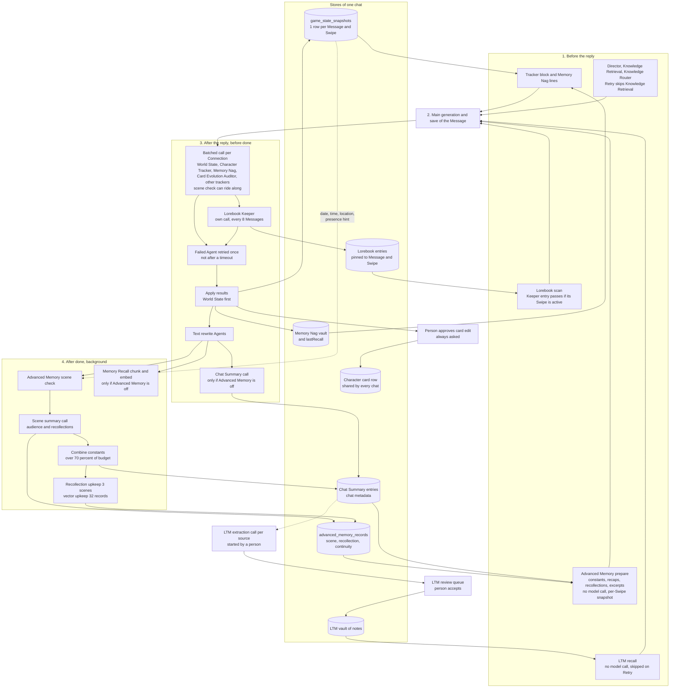

# How Marinara Engine keeps memory with its agents

Ticket: [Find how Marinara Engine keeps memory with its agents](../issues/01-marinara-memory.md)

This asset reads Marinara Engine (ME) in depth. It does not choose a design. Three later tickets use its facts: [05](../issues/05-memory-candidates.md), [06](../issues/06-story-clock.md) and [07](../issues/07-card-change.md).

Labels: **known** (read in code, in a doc or in a test), **inferred** (reasoned from a read, not measured), **guessed**. Where the source does not answer, the text says "I don't know".

## Sources and cite forms

| Short | Tree | Commit | Note |
|---|---|---|---|
| `E` | Marinara Engine, `/tmp/research/marinara` | `457e827a3d3291be978121f8c50c98c5dd9d644d` (2026-10-21) | `srv/` is `packages/server/src/`, `shr/` is `packages/shared/src/`, `cli/` is `packages/client/src/`. |
| `A` | Marinara-Agents, `/tmp/research/marinara-agents` | `f9a05f761b8019c95078f956d1de8889b6021e98` (2026-10-23) | A shallow clone of one commit. The map does not pin it. |

**Why two trees (known).** `E` carries no prompt of a downloadable Agent. `shr/constants/agent-prompts.ts:124` says so, and `shr/features/agents/agent-registry.ts:4` starts the list of manifests empty. `docs/agents/built-in-agents.md:3` says that Agents do not ship in a fresh install. The prompts of Lorebook Keeper, Memory Nag, Card Evolution Auditor, the trackers and Long-Term Memory (LTM) live in `A`. Two days separate the two commits. `A` can differ from the prompt that a user of `E` had (inferred).

**Terms.** ME words on the left, our words on the right. ME "chat" is our Game. ME "reply" is our Narration. ME "regenerate" is our Retry. ME "persona" is our Persona. ME "swipe" is our Swipe. ME "Helper model" is a second Connection for memory calls. ME "Narrator" in Advanced Memory is a Character that sees everything. It is not our narrator.

## Short answer

- **known** ME has no single memory design. It has eight separate writers (Advanced Memory counts as one). Within one reply, no post-processing Agent reads the output of another. Each writer owns its store, and only the Chat Summary entries have two writers (section 2).
- **known** The writer that matches our faults best is **Advanced Memory**. It cuts the story into scenes, writes one recap of each scene, records who was present, and can add a first-person recollection for each Character present. It is off by default and works in Roleplay chats only.
- **known** Advanced Memory keeps a Character memory only for the Characters in the scene. A Character who was absent gets no entry about that scene. The other writers differ: the Relationship Tracker, Memory Nag and LTM do not check presence (section 3).
- **known** ME records no clock for memory. The World State Agent writes free-text `date` and `time` for each Swipe. A memory record gets its story time from a regex over the Message text, or from a hand edit. LTM notes carry only real-world timestamps (section 4).
- **known** The Card Evolution Auditor writes a proposal. A person must approve it. The approved edit changes the one shared Character row of every chat. ME has no card change that belongs to one Game (section 5).
- **known** Only the Lorebook Keeper, the trackers and the Advanced Memory prompt snapshot follow a Swipe. Chat Summary entries, Memory Nag memories and LTM notes do not (section 6).
- **known** The tests prove plumbing with scripted models. **I don't know** of any measure of how well a memory finds the right fact (section 8).

## 1. The agents

### 1.1 Table of the writers and readers of memory

"Call" means one model call. "Msg" means one Message (user or assistant). Default is the state of a fresh chat.

| Agent or service | Stores | Trigger | Input | Call and cost for each Msg | Default |
|---|---|---|---|---|---|
| **Advanced Memory: scene check** | The end of a scene, as a Message number. Saved as a structural record with `kind: "scene"`. | After a reply, once 5 new Message IDs exist (`sceneCheckInterval`). Not on a Retry. | Up to 10 Messages since the last check, plus the last checked Message (`E srv/services/advanced-memory.ts:3647-3665`; `E srv/routes/generate.routes.ts:14668`). | 1 call per 5 Msg. The call can ride on a tracker call (0 extra calls) when a tracker is on and the Decision model is off (`E srv/routes/generate.routes.ts:11905-11945`). | Off. `enabled: false` (`E shr/types/advanced-memory.ts:14`). |
| **Advanced Memory: scene summary** | One recap per closed scene, its audience (names of Characters present), a story timeframe, and optional recollections (`E shr/types/advanced-memory.ts:117-140`). | When the scene check closes a scene. | All eligible Messages of the scene, hand corrections, and (if on) the full cards of the Characters in it (`E srv/services/advanced-memory.ts:1784-1860`). | 1 or more calls for each closed scene. Output is at least 8196 tokens reserved, and the recap asks for 2–3 paragraphs (`:1857`, `:1868`). | Off, with the whole service. |
| **Advanced Memory: Character recollection** | One record per Character per scene, 50–100 words, first person (`kind: "recollection"`). | Same call as the scene summary. A scene with a summary but no recollection gets a call of its own. Upkeep writes at most 3 scenes after each reply (`:241`, `:4010-4021`). | The scene and the card of that Character. | 0 extra calls when written with the summary. Otherwise 1 call per scene (or per card, if cards are large). | Off. `characterRecollections: false` (`E shr/types/advanced-memory.ts:31`). |
| **Advanced Memory: constant summaries** | Chat Summary entries, combined and shortened. | After a reply, when the summaries that one reader sees pass 70% of `summaryBudgetTokens` (`:4430`). | The entries to combine. | 1 call per combine step, in the background. | Off. |
| **Advanced Memory: Decision model, visibility** | Scene starts, scene scores, and which Characters could see each new Message (`hiddenFromAICharacterIds`). | Decision model: each scene check and each recall. Visibility: each new Message in Individual group chats. | Small classifier calls. | Decision: up to 2 passes for each reply, at most 40 s (`E srv/services/advanced-memory-decisions.ts:28`). Visibility: shares the scene-check call when one is due. | Both off (`E shr/types/advanced-memory.ts:19`, `:29`). |
| **Advanced Memory: recall** | Nothing. It reads records and builds three prompt parts. | Before each reply. | Scene recaps, recollections and excerpts. Ranked by text match, embeddings, and an optional Decision model. | 0 model calls without the Decision model. 1 query embedding with a 1.5 s limit (`:5189`). | Off. |
| **Chat Summary** | `summaryEntries` in chat metadata. Each entry has a title, text, a Message range and `messageIds`. No Swipe pin (`E shr/utils/chat-summary-entries.ts`, no `swipe` key). | Every 5 Msg (user and assistant) since the last anchor (`E srv/services/generation/roleplay-summary-runtime.ts:14`; `E srv/services/conversation/auto-summary.service.ts:20-31`). Skipped when Advanced Memory is on (`E srv/routes/generate.routes.ts:11694`). | The previous summary plus up to 50 recent visible Messages (`roleplay-summary-runtime.ts:45-48`; `generate.routes.ts:11753-11767`). | 1 call per 5 Msg. Output at most 4096 tokens by default (`docs/agents/memory.md:263`). | Off unless `automaticSummaryEnabled` is true (`roleplay-summary-runtime.ts:59-63`). |
| **Memory Recall** | `memory_chunks`: 5 Messages each, with an embedding. | After each reply, once 5 Messages wait (`E srv/services/memory-recall.ts:18`). | The Message text. | 0 completion calls. Embeddings only. | On in Conversation and Scene chats. Off in Roleplay (`generate.routes.ts:5455-5457`). |
| **Long-Term Memory (LTM)** | A vault of typed notes: timeline events, Character facts, relationship states, world facts, threads, anchors, tone (`A packages/long-term-memory/.../constants.ts:12-20`). | **Extraction:** a person starts it on a source, such as a Chat Summary entry (inferred: I found no scheduler in the package). **Recall:** before each reply. | Extraction reads one source note. Recall reads recent Messages. | Extraction: 1 call per source, 8192 output tokens by default. Recall: 0 model calls (`E srv/services/generation/long-term-memory-runtime.ts:118-135`). | Off. `runtimeDisabled: true`, `execution: feature` (`A packages/long-term-memory/agents.json`). |
| **Lorebook Keeper** | Lorebook entries, each with `sourceAgentId` and `sourceMessageRefs` (Message ID and Swipe index) (`E shr/types/lorebook.ts:148-160`, `:265-280`). | Every 8 Msg since its last success (`generate.routes.ts:6129-6150`; `A packages/lorebook-keeper/agents.json:20`). | The last 5 Messages (default Agent context, inferred), the latest reply, the existing entries, and the list of writable lorebooks. | 1 call per 8 Msg. It runs alone, never in a batch (`E srv/services/agents/agent-executor.ts:2063-2080`). It runs after the tracker batch (`generate.routes.ts:12109-12131`). | Off. |
| **Memory Nag** | A vault in package storage. Each memory has text (at most 500 characters), `characterIds`, a status, and `sourceMessageIds` (`A packages/memory-nag/.../scanner.ts:121-160`). | **Pick:** each reply. **Scan:** when 20 new Messages wait (`scanner.ts:380-389`). | Pick: at most 5 candidate memories for each Character, plus the recent Messages. Scan: 20 Messages, the Character list and the active memories. | Pick: 1 call per reply, batched with trackers, at most 4096 output tokens. Scan: 1 call per 20 Msg. | Off. |
| **Card Evolution Auditor** | A list of proposed edits. It stores no state itself. | Every 8 Msg since its last success (`generate.routes.ts:6484-6499`). | The full text of each card field of the Characters in the chat, the last 5 Messages (inferred), and the reply. | 1 call per 8 Msg, batched. | Off. |
| **Director: Secret Plot** | A hidden story arc (`overarchingArc`) in the Agent memory of the chat (`generate.routes.ts:6989`). | Every 8 Msg when `secretPlotEnabled` (`A packages/director/agents.json`). | The scenario, cards, summary and recent Messages. | 1 pre-generation call per 8 Msg. A failure **stops the generation** (`generate.routes.ts:7179-7216`). | Off. |

### 1.2 Table of the state writers

These write state, not memory. They matter for the three memory faults ("who is here", "what time is it"). All are off by default and run each reply, batched into one call per Connection.

| Agent | Stores in `game_state_snapshots` (one row for each Message and Swipe) | Key prompt rule |
|---|---|---|
| **World State** | `date`, `time`, `location`, `weather`, `temperature`, custom world fields (`E srv/db/schema/game-state.ts:13-19`). | "Preserve the previous state unless the latest narrative explicitly changes it ... Conversation beats should push time forward by a minute or two, while a scene change can carry a fast-forward of a few hours" (`A packages/world-state/agents.json:15`). |
| **Character Tracker** | `presentCharacters`: mood, appearance, outfit, thoughts, stats. | "Characters persist until they clearly leave, are dismissed, or the scene moves away from them." A returning Character reuses its latest saved stats (`A packages/character-tracker/agents.json:12`; `docs/agents/built-in-agents.md`, Character Tracker). |
| **Relationship Tracker** | Relationship edges and each Character's view of the Persona (package storage). | "Do not gate tracking from scene presence." "Include only pairs directly and durably added, changed, or made undefined" (`A packages/relationship-tracker/agents.json:31`). |
| **Persona Stats, Quest, Inventory, Custom Tracker, Beholder** | Persona bars, quests (3 active at most), money and items, user fields, wounds and clothes. | Each one has its own JSON schema. Beholder runs alone (`agent-executor.ts:2063-2080`). |

### 1.3 Readers and other parts

| Part | What it does with memory |
|---|---|
| **Continuity Checker** | Reads tracker data "as read-only reference". Rewrites the reply to fix "spatial, timeline, and physical logic errors", such as "noon cannot become night without a time skip" (`A packages/continuity/agents.json:18`). It is the only Agent that checks the reply against the state. |
| **Knowledge Retrieval and Knowledge Router** | Read lorebook entries before the reply. Retrieval summarizes them. The Router picks entry IDs. Both skip a Retry (`generate.routes.ts:6959-6970`). |
| **Narrator tools** `append_chat_summary`, `save_lorebook_entry`, `write_chat_variable`, `edit_chat_message` | They exist, but they are "agent only" and off for the narrator by default (`E srv/services/generation/tool-resolution-runtime.ts:156-175`). The tool `update_game_state` takes only `location_change` and `time_advance` (`E srv/services/tools/tool-executor.ts:613-626`). Tools are off unless a chat turns them on (inferred, `tool-resolution-runtime.ts:242-243`). |
| **About Me Keeper** (Conversation mode only) | Writes an "about me" text for a Character. A chat-only version is saved to chat metadata with no approval. A public version goes to the approval window (`generate.routes.ts:13388-13445`). Section 5.2 uses it. |

### 1.4 The prompts that decide behaviour

Only the rules that change what the writer stores are quoted.

**Scene check** (`E srv/services/advanced-memory.ts:376-377`):
"Report the exact messageNumber whose END clearly finishes a scene ... A mood change alone is not a scene ending. ... Uncertainty means no boundary. ... The next scene begins AFTER the reported message."

**Scene summary** (`:1836-1838`, with `:1824-1828`):
"write a self-contained historical recap of the supplied events. Omit 'current situation', 'open tensions', unresolved-thread lists, predictions, and next steps. Record what happened and its outcomes without treating past states as current."
"Message visibility annotations are authoritative: facts from a restricted message must stay in a condition for its permitted readers."

**Audience** (`:1839`):
"A character merely mentioned, remembered, discussed, or addressed while absent is NOT a participant. ... Never assign an absent character just because the scene is about them. ... Empty, unknown, or user-only participation means [] (narrator only)."

**Recollection** (`:259-260`):
"written in the first person and in their voice, about 50–100 words ... A character can use only the messages they could know: skip every message whose visibility note does not name them ... never for the narrator, the user or their persona, or a character who was elsewhere."

**Chat Summary** (`E shr/constants/agent-prompts.ts:10-16`):
"Summarize only NEW durable roleplay events not already captured in the existing summary. ... Write an appendable continuation. Do not rewrite or repeat the previous summary."

**Lorebook Keeper** (`A packages/lorebook-keeper/agents.json:22`):
"Record only durable facts from the latest assistant response ... Skip trivial actions, temporary moods, ordinary scene beats, facts already captured by <chat_summary> ... Update an exact matching entry instead of creating a duplicate, and never modify locked entries. For updates, return only atomic newFacts to append."

**Memory Nag, pick** (`A packages/memory-nag/agents.json:32`):
"Choose only IDs listed in allowedMemoryIds ... Never create, rewrite, or combine a memory. ... Do not select a memory that only repeats the immediate scene."
**Memory Nag, scan** (`A packages/memory-nag/.../schema.ts:7-14`):
"Capture promises, meaningful actions, relationship changes, mistakes, debts, injuries, and memorable admissions. ... A memory can belong to more than one character. ... Resolve an existing memory only when this batch clearly settles it."

**Card Evolution Auditor** (`A packages/card-evolution-auditor/agents.json:12`):
"propose user-reviewed card edits only when a durable established fact now contradicts or meaningfully extends the saved card. ... Ignore temporary mood, current scene location, transient clothing, injuries already healed, and vague implications. ... exact oldText copied verbatim ... False positives are worse than missed changes."

**LTM summary prompt for import** (`E shr/constants/agent-prompts.ts:27-97`): "Extract only explicit, future-useful continuity. Do not invent, infer, intensify, or resolve ambiguity." "Do not duplicate content across streams. `timeline_event` owns event prose."

## 2. How the agents work together

### 2.1 The order in one reply

All cites are `E srv/routes/generate.routes.ts` unless named. **known**.

1. **Before the reply.** The tracker block is built from the last committed row (`:6519`). Pre-generation Agents run (`:6927-7216`). A failed Secret Plot stops the generation (`:7179-7216`). LTM recall runs unless this is a Retry (`:7428`). Advanced Memory builds its three prompt parts from stored records (`:8539`).
2. **The reply** is generated and saved.
3. **After the reply, before `done`.**
   - One batched call for each Connection runs the post-processing Agents (`:12100`; `E srv/services/agents/agent-pipeline.ts:80-110`). Agents with the same provider and model share one call that returns a JSON map keyed by Agent.
   - The Lorebook Keeper runs next, in its own call (`:12109-12131`).
   - A failed Agent is retried once, unless it timed out (`:12151-12160`; `E srv/routes/generate/agent-result-capabilities.ts:13-16`).
   - The results are applied. `game_state_update` is applied first, because the other trackers merge into that row (`:12403-12406`).
   - Text rewrite Agents run last (`:14121`).
   - Chat Summary runs, only when Advanced Memory is off (`:14358`).
4. **After `done`.** The server sends `done` and releases the chat (`:14767-14769`). Advanced Memory then runs in the background (`:14668-14690`): scene check, scene summary, constant combine, recollection upkeep, vector upkeep (`E srv/services/advanced-memory.ts:3809-4008`). With Advanced Memory off, Memory Recall chunks and embeds instead (`:14698-14711`).
5. **The next reply** reads what steps 3 and 4 saved. It never waits for step 4 (`docs/agents/memory.md:183-185`).

### 2.2 Who reads the output of whom

| Reader | Reads | How | Label |
|---|---|---|---|
| The next reply | The last committed tracker row | Injected before the newest history block (`E srv/routes/generate/generate-route-utils.ts:623-657`). | known |
| Advanced Memory scene check and recall ranking | Tracker `date`, `time`, `location` and presence (80 characters each), and mood and relationship fields (400 characters) | Hints only (`advanced-memory.ts:2665-2718`, used at `:2762-2770` and `:5195-5212`). | known |
| Advanced Memory | Chat Summary entries and hand corrections | Inputs to its summary calls (`:2536-2565`, `entryInput` `:278`). | known |
| LTM | Chat Summary entries, day and week summaries, lorebooks, cards | Read as sources (`A packages/long-term-memory/docs/ARCHITECTURE.md`, "Engine fields read directly"). | known |
| Any Agent | Advanced Memory recall | **No.** "agent calls ... neither trigger it nor receive its returned summaries or excerpts" (`docs/agents/memory.md:183`). | known |
| One tracker | The output of another tracker of the same reply | **No.** They share one call. A post-processing Agent sees same-reply pre-generation or parallel output only if it opts in (`agent-pipeline.ts:159-172`). | known |
| Lorebook Keeper | Chat Summary | Its prompt says to skip facts "already captured by <chat_summary>". Whether the summary reaches it by default: **I don't know.** | guessed |

### 2.3 Which agents share one call

- **known** Trackers on one Connection share one call. Beholder, Illustrator, Lorebook Keeper, text rewrite Agents and any Agent with `batchWithOtherAgents: false` run alone (`agent-executor.ts:2063-2080`).
- **known** The Advanced Memory scene check rides in that call when a tracker is on and the Decision model is off (`generate.routes.ts:11905-11945`). With the Decision model on, it has its own request (`docs/agents/memory.md:183`).
- **known** In Individual group chats the visibility question rides in the scene-check call (`advanced-memory.ts:3916-3942`).
- **known** The batch has a known weakness, and ME patches it in code. A batch answer can mix the schemas of different Agents. So the World State handler always carries the other fields forward from the previous row (`generate.routes.ts:12692-12700`).

### 2.4 When two of them disagree

ME has no arbiter. Each writer owns its store. Rules in the code limit the damage.

| Case | Rule | Label |
|---|---|---|
| A tracker value and a person's edit | `manualOverrides`, `fieldLocks` and `hiddenTrackerFields` keep the edit. A later tracker run that changes the field retires the edit (`E srv/services/storage/game-state.storage.ts:350-413`). | known |
| A generated summary and a hand edit | `manualOverride: true` makes the record authoritative. Fix "never rewrites a summary you edited by hand" and lists it for review (`docs/agents/memory.md:115`; `advanced-memory.ts:1251-1264`). | known |
| A recollection and its scene summary | A recollection counts only while the summary text is unchanged and the owner could read the same Messages (`advanced-memory.ts:284-299`). | known |
| A recollection and what the Character could not know | The recollection is dropped if it copies a run of four words from a Message hidden from that Character (`:2252-2286`). | known |
| A private part and a wider part of a combined summary | The combine is rejected if a private run reaches more readers (`:4472-4490`, `:4588`). | known |
| The Keeper and a person | A person's edit of an entry clears `sourceAgentId`. The entry is then immune to the delete cascade (`E shr/types/lorebook.ts:265-272`). | known |
| The Keeper and the Chat Summary | Only the prompt asks the Keeper to skip duplicates. No code checks it. | inferred |
| Memory Nag and the vault | Code keeps only IDs from the shortlist, at most 3 (`A packages/memory-nag/.../selection.ts:17-33`). | known |

Priority in one prompt, when space is short: constants first, then scene summaries, then recollections, then excerpts. Excerpts shrink first. Whole recollections go next. A recollection is never cut short (`docs/agents/memory.md:89`, `:173`).

## 3. Story memory and Character memory

### 3.1 How ME separates them

| Part | Rule | Cite | Label |
|---|---|---|---|
| Story memory | The scene recap and the Chat Summary entries. The Advanced Memory "Narrator" reads every part of every summary. | `docs/agents/memory.md:195`; `advanced-memory.ts:2574-2584` | known |
| Audience list | `audienceCharacterIds` on a scene or excerpt record. Empty means narrator only, never all Characters. The model writes it in the same call as the recap. | `E shr/types/advanced-memory.ts:128-129`; `advanced-memory.ts:1839` | known |
| Name matching | A short name matches only one Character and never a Persona name. A name with a note such as "(mentioned)" gives no access. | `docs/agents/memory.md:201`; `advanced-memory.ts:666-700` | known |
| Failed audience | In a group chat, a scene whose model names nobody goes to every Character and is marked "Check who was there". | `CHANGELOG.md:301` | known |
| Private parts | `{{#if char == "Name"}}...{{/if}}` sections inside one recap. Rendering keeps the sections of the reader only. | `advanced-memory.ts:1820-1823`, `:2574-2621` | known |
| Recollection | 50–100 words, first person, one for each Character in the audience. Never for the narrator, the Persona or an absent Character. | `:259`, `:2171-2178` | known |
| `knowledgeStarts` | One Message ID for each Character. Before it, that Character knows nothing. `null` confirms "from the beginning". A missing value blocks the job. | `E shr/types/advanced-memory.ts:32-33`; `advanced-memory.ts:839-852`, `:566-575` | known |
| Hidden Messages | `hiddenFromAICharacterIds` hides a Message from named Characters. `autoMessageVisibility` lets the model set it. | `advanced-memory.ts:362-363`, `:585` | known |
| Leak check | Four-word runs. Applied when a recollection is saved and when a combine is saved. Not applied when a prompt is built. | `:2252-2286`, `:4472-4490` | known |
| What the leak check misses | "A fact retold in other words is not caught this way; only the instructions guard against it." The code comment agrees: "a reworded private fact in a wider section still passes". | `docs/agents/memory.md:166`; `advanced-memory.ts:4586` | known |
| Persona memory | None. The Persona is not a participant. It gets no recollection. Its name gives no access. | `:259`; `docs/agents/memory.md:201` | known |

**Scope limit (known).** Per-Character separation applies in Roleplay chats only (`advanced-memory.ts:1099`). `knowledgeStarts` and the per-Character Message rules apply only when `groupChatMode === "individual"` (`:1127`, `:839-841`). In a merged group chat, one reply speaks for every Character. Recall then includes what at least one present Character remembers, marked "known only to Kaito" (`:4667-4678`; `docs/agents/memory.md:205`). **inferred** The merged mode is the closest ME shape to our one narrator.

### 3.2 Does a Character memory change while the Character is absent?

The owner's working view says yes (map Notes). ME says no for its main writer, and yes for three others.

| Writer | While the Character is absent | Cite | Label |
|---|---|---|---|
| Advanced Memory recap and recollection | **No.** The audience holds only Characters present. The prompt says "Never assign an absent character just because the scene is about them." A Character that was never in a scene gets no recap and no recollection of it. | `advanced-memory.ts:1839`, `:2171-2178` | known |
| Advanced Memory, after the Character returns | It gets nothing for the scenes it missed. The merged mode shows a scene to the Character if any present Character remembers it. | `:4667-4678` | known |
| Character Tracker | The row ends when the Character leaves. On return it reuses the latest saved stats. It does not change while absent. | `A packages/character-tracker/agents.json:12`; `docs/agents/built-in-agents.md`, Character Tracker | known |
| Relationship Tracker | **Yes.** "Do not gate tracking from scene presence." A pair can change while one is absent. | `A packages/relationship-tracker/agents.json:31` | known |
| Memory Nag scan | **Yes, probably.** The scan reads all Messages of a batch. The model picks any Character ID from the list of all chat Characters. No code checks presence. | `A packages/memory-nag/.../scanner.ts:168-197`, `participants.ts:15-33` | inferred |
| LTM | **Yes.** A Character fact goes to "the character it names", from any summary. | `A packages/long-term-memory/CHANGELOG.md:40`; `constants.ts` core rules | known |

**inferred** ME's answer to the owner's view is split. Its design makes the Character memory a record of what the Character took part in. A record of what happened to an absent Character exists only where a writer reads the whole story and names the Character (Memory Nag, LTM, Relationship Tracker). ME shows no test of that case.

## 4. Time

| Question | Answer | Cite | Label |
|---|---|---|---|
| Fields | `date`, `time`, `weather`, `temperature` and `location`. Each is a nullable free-text string on the snapshot of one Message and Swipe. | `E srv/db/schema/game-state.ts:13-19` | known |
| Who writes `date` and `time` | The World State Agent, after each reply. The narrator can write `time` through the tool `time_advance`. Tools are off unless a chat turns them on (inferred from `booleanText`). | `generate.routes.ts:12637-12638`; `tool-executor.ts:613-626`; `tool-resolution-runtime.ts:242-243` | known |
| How the value moves | "Preserve the previous state unless the latest narrative explicitly changes it or strongly implies a change ... Conversation beats should push time forward by a minute or two, while a scene change can carry a fast-forward of a few hours." The code falls back to the previous value when the model gives none. | `A packages/world-state/agents.json:15`; `generate.routes.ts:12637-12638` | known |
| Does code read the value | No parser found. The prompt shows it as `Date: ...` and `Time: ...` lines (`committed-tracker-context.ts:186-187`). Music code reads a time-of-day word. I found no arithmetic on `time`. | `E srv/services/generation/committed-tracker-context.ts:186-187` | inferred |
| Does a memory record carry time | A scene record has `timeline: string \| null`. It is **not** the World State value. It comes from `sourceTimeline`: a regex over the Message text for a line `Date:`, `Story time:` or `Time:`, or an opening phrase such as "the following morning". It shows the first and last anchor as "A → B". | `E shr/types/advanced-memory.ts:132`; `advanced-memory.ts:971-987`, `:1002-1018` | known |
| When no time is found | The prompt says `story timeframe: unknown (use message order)`. The docs say "unknown dates stay unknown". | `advanced-memory.ts:1017`; `docs/agents/memory.md:199` | known |
| Who can fix it | A person edits "Story timeframe" in the memory viewer. The edit takes precedence. | `advanced-memory.ts:5915-6060`; `CHANGELOG.md:928` | known |
| Tracker data and the timeline | Tracker `date`, `time` and `location` help the model find scene boundaries. They do not fill `timeline`. | `advanced-memory.ts:2665-2691`, `:2762-2770` | known |
| LTM | A note has `createdAt` and `updatedAt` only. I found no story-time field. | `A packages/long-term-memory/.../schema.ts:451`, `:949` | inferred |
| Memory Nag, Lorebook Keeper | No time field. A Memory Nag memory and a lorebook entry carry `createdAt` and `updatedAt` only. | `A packages/memory-nag/.../schema.ts:45-53`; `E shr/types/lorebook.ts:282-283` | known |
| Continuity Checker | The only check of time against the reply. "noon cannot become night without a time skip." It rewrites the reply. | `A packages/continuity/agents.json:18` | known |
| Conversation mode | Day and week summaries use the real calendar. A "Day Rollover Hour" splits days. | `docs/agents/memory.md:275-326` | known |

**I don't know** how Game mode keeps its clock. I did not read it.

## 5. Card changes

### 5.1 How the Auditor works

| Step | What happens | Cite | Label |
|---|---|---|---|
| Trigger | Every 8 Messages since its last successful run, and on the first run. Off by default. | `generate.routes.ts:6484-6500`; `E srv/services/generation/agent-cadence.ts:36-58`; `A packages/card-evolution-auditor/agents.json:7-10` | known |
| Input | `<character_cards>` holds every text field of each Character in the chat. The prompt asks for edits to `description`, `personality`, `scenario`, `first_mes`, `mes_example`, `creator_notes`, `system_prompt`, `post_history_instructions`, `backstory`, `appearance`. | `E srv/services/agents/agent-executor.ts:3141-3158` | known |
| Recent text | The default Agent context is 5 Messages. The run interval is 8. So the Auditor sees 5 of the last 8 Messages. | `E shr/types/agent.ts:594`; `agent-executor.ts:2326` | inferred |
| What it finds | A fact that is "durable ... still true going forward: changed job, home, body, powers, core beliefs, relationships, backstory, appearance, or long-term circumstances". | `A packages/card-evolution-auditor/agents.json:12` | known |
| What it ignores | "temporary mood, current scene location, transient clothing, injuries already healed, and vague implications." "False positives are worse than missed changes." | same | known |
| Output | `{"updates":[{"action","characterId","field","oldText","newText","reason"}]}`. `oldText` must be copied word for word. "If oldText is not present in the card, skip it." | same | known |
| Approval | Always asked, "even when Review Agent Outputs is off. You cannot turn that safety check off." The person can edit `newText`, **Approve**, **Regenerate** or **Reject**. | `docs/agents/approvals-and-agent-suite.md:19`, `:39-56` | known |
| Stale check | The modal marks an edit stale if `oldText` is no longer a substring of the field. **Override stale** appends `newText` and does not replace. | `E cli/components/modals/CharacterCardUpdateModal.tsx:138-150`, `:173-210` | known |
| Write | Replace `oldText` by `newText` in the field. Raise `character_version`. Save through `updateCharacter` with `versionSource: "agent"`. | `CharacterCardUpdateModal.tsx:206-218` | known |
| Where it lands | The `characters` row of that Character. The row has no chat, Message or Swipe key. A version row holds a full snapshot, `source` and `reason`. | `E srv/db/schema/characters.ts:6-36` | known |
| How it reaches the prompt | Each generation reads the card row again. | `E srv/services/prompt/marker-expander.ts:222-232`; `E srv/services/generation/character-prompt-context.ts:128-140` | known |

### 5.2 What the approval protects against

**inferred** The approval is the only guard. The write has no Game scope. Four risks follow from the schema:

1. **The card is shared.** One approved edit changes that Character in every chat and in the author's library. Version history is the only way back.
2. **No link to the cause.** The version row records the Agent name, not the Message or the Swipe. A Retry or a delete of the source Message does not undo the edit.
3. **A false positive stays.** The prompt itself says false positives cost more than misses.
4. **A stale base.** The person can edit the card between the proposal and the approval. The `oldText` check catches that.

**known** ME does have a chat-local pattern, in one place. The About Me Keeper writes a chat-only text to chat metadata (`conversationAboutMeOverrides`) with no approval. It sends a public edit to the same approval window. The code comment calls the chat-only write "low stakes, this chat only" (`generate.routes.ts:13388-13420`). It works in Conversation mode and for one field.

## 6. Swipe, edit and delete

"Retry" makes a new Swipe of the last Message. "Switch" selects another Swipe. "Edit" changes the text of an older Message. "Delete" removes a Message.

| Writer | Retry | Swipe switch | Edit of an older Message | Delete |
|---|---|---|---|---|
| **Trackers** (`game_state_snapshots`) | New row for the new Swipe. Its base is the row of the sibling Swipe, with Tracker Panel edits laid over it (`generate.routes.ts:12421-12432`; `game-state.storage.ts:305-350`). Agents of an abandoned Swipe are aborted (`:1432-1455`). | The row of the active Swipe is used. | Not read. **I don't know.** | Rows of that Message and its checkpoints are deleted (`chats.storage.ts:1225-1262`). |
| **Advanced Memory** prepared prompt | The new Swipe reuses the earliest compatible saved snapshot. No new search or helper call (`docs/agents/memory.md:185`; `E srv/services/generation/advanced-memory-context.ts:104-122`). | Same snapshot rule. | "User changes to history ... invalidate incompatible snapshots", so recall runs again (`docs/agents/memory.md:185`). A text edit changes the source fingerprint (`advanced-memory.ts:413-448`). A test shows `prepare` rejecting an edited source (`advanced-memory-core.regression.ts:327-337`). | Same. |
| **Advanced Memory** scene recap | The scene check does not run on a Retry (`generate.routes.ts:14668`). A saved recap stays. | A saved recap stays. A later scene check removes the boundary of the old Swipe if the new one has none (`advanced-memory-core.regression.ts:2088-2112`). | A finished recap and its vector **stay** after a text edit ("Finished archive entries keep their source IDs and index across text edits, swipes ..."). The recap can then describe the old text. | A recap with a missing Message is invalid (`advanced-memory.ts:1186-1192`). The scene counts as unprepared and Fix writes it again (**inferred**). |
| **Chat Summary** | Cadence counts Messages after an anchor. A Retry of the anchor adds none (`auto-summary.service.ts:20-31`). | No Swipe key in the entry. The text stays. | The text stays. | I found no cascade. The entry stays (**inferred**). |
| **Memory Recall** chunks | Chunks from the changed Message onward are deleted, then built again (`chats.storage.ts:742-763`, calls at `:2745`, `:3506`, `:3544`). | Same. | Same. | Same (`:3313`, `:3359`). |
| **LTM** | No recall on a Retry. It reuses the cached injection (`generate.routes.ts:7428`, `:7318-7327`). | Not read. | A note comes from a source such as a summary entry. A Message edit does not reach it (**inferred**). | Not read. **I don't know.** |
| **Lorebook Keeper** | The entry is pinned to the Swipe in `sourceMessageRefs`. | A pinned entry is excluded while its Swipe is not active. It returns when the person swipes back (`E srv/services/lorebook/index.ts:1310-1346`). | An edit of the entry by a person clears `sourceAgentId`. An edit of a Message does nothing. | The cascade restores the entry to `previousContent`, or removes it (`chats.storage.ts:789-806`, `:1270-1316`). |
| **Memory Nag** | The vault keeps `sourceMessageIds` and no Swipe. `lastRecall` is one chat-level value. The next run replaces it (`A packages/memory-nag/.../agent-runtime.ts:103-130`). | No effect. | No effect. | The scan checkpoint is a Message ID. If it is gone, the scan restarts at 0 (`scanner.ts:199-205`). Duplicate text is skipped (`:121-140`). So the vault can gain repeats of changed facts (**inferred**). |
| **Card Evolution Auditor** | A proposal is not state. | No effect. | No effect. | No effect. An approved edit stays. |

**known** ME gives four answers to the same event. A Swipe pin (Keeper), a row for each Swipe (trackers), a snapshot for each Swipe (Advanced Memory prompt) and no rule (Chat Summary, Memory Nag, cards).

## 7. Failure and the cap

### 7.1 What each agent does when its call fails

| Agent | On failure | Cite | Label |
|---|---|---|---|
| Advanced Memory (any call) | The error is logged. The reply is not affected. The job shows `error` and a person can **Resume**. Paid partial work is cached. "A failed model call preserves previously valid memory and displays an error to retry." | `generate.routes.ts:14685`; `docs/agents/memory.md:98`; `advanced-memory.ts:1789-1806` | known |
| Advanced Memory, a recollection | The scene gets an empty record marked `recollection-attempt: failed`. Upkeep skips it. Other scenes go on. **Resume** tries again. | `advanced-memory.ts:2406-2535` | known |
| Advanced Memory, a Decision model call | It falls back to the helper scene check, and to ordinary recall for the scenes it did not judge. | `docs/agents/memory.md:133` | known |
| Advanced Memory, visibility | Nothing is hidden for that Message. | `docs/agents/memory.md:147` | known |
| Chat Summary | A warning in the log. The reply is not affected. The anchor does not move, so the next reply tries again. | `generate.routes.ts:14355-14361` | inferred |
| Memory Recall | "Recall failed, skipping." The reply goes on with no recalled text. | `E srv/services/generation/memory-recall-context.ts:91-93` | known |
| LTM recall | A warning. "continuing without recalled context." A timeout is `getAgentCallTimeoutMs()`. | `E srv/services/generation/long-term-memory-runtime.ts:118-135` | known |
| LTM extraction | The source stays failed. A person can retry it. | `A packages/long-term-memory/CHANGELOG.md` 1.4.52 | known |
| Lorebook Keeper | Retried once, unless it timed out. If it still fails, no entry is written (the writer needs `result.success`). | `generate.routes.ts:12151-12160`, `:13305` | known |
| Memory Nag, pick | Nothing is written. The old `lastRecall` stays and the next prompt can repeat the old reminder. | `A packages/memory-nag/.../agent-runtime.ts:103-130`, `prompt-context.ts:45` | inferred |
| Memory Nag, scan | A warning. The checkpoint does not move. The next reply tries again. | `agent-runtime.ts:139-150`; `scanner.ts:314-340` | known |
| Card Evolution Auditor | Retried once. No proposal. No state to keep. | `generate.routes.ts:12151-12160` | known |
| Trackers | Retried once. No row is written. The previous row stays. A model that returns no `presentCharacters` keeps the stored row. World State falls back to the previous `date` and `time`. | `generate.routes.ts:12637-12638`; `retry-agents-route.ts:3250-3258` | known |
| Director Secret Plot | **The generation stops.** | `generate.routes.ts:7179-7216` | known |

### 7.2 What ME does when the memory text passes its cap

| Writer | Cap | What happens over the cap | Cite | Label |
|---|---|---|---|---|
| Advanced Memory, constants | 70% of `summaryBudgetTokens` for one reader (`constantBudget`) | A background call combines and shortens the summaries. Until then, a head-and-tail excerpt with "[Earlier context omitted from this request to fit its context limit.]" goes in the prompt. | `advanced-memory.ts:4430`, `:4930-4941` | known |
| Advanced Memory, live history | `maxContextTokens` (default 65,000) | The live window **resets to the start of the latest scene** (`scene-boundary-rollover`), then grows again. If no scene boundary helps, the old part of the open scene becomes one excerpt of at most 1024 tokens (`open-scene-prefix-excerpts`). | `advanced-memory.ts:4912-4966`; `docs/agents/memory.md:187` | known |
| Advanced Memory, optional recall | `summaryBudgetTokens` + 2000 − constants − scene | Fewer scenes. Excerpts shrink first. Whole recollections go next. If the formatted request still does not fit, all recall is dropped. | `advanced-memory.ts:4970-4975`; `advanced-memory-context.ts:155-179` | known |
| Advanced Memory, request | The context limit | It throws instead of cutting: "Advanced Memory stops instead of silently deleting instructions." | `E srv/services/llm/base-provider.ts:364-372`; `docs/agents/memory.md:225` | known |
| Chat Summary | 200 automated entries | The oldest enabled automated entries go, unless they hid Messages. There is no cap on the text of one entry. | `E shr/utils/chat-summary-entries.ts:174-186` | known |
| Chat Summary, in the prompt | The context limit | The generic fit drops the oldest history, then the oldest removable system Messages, then truncates the largest system Message. | `base-provider.ts:349-570` | known |
| Memory Recall | 15% of context, from 384 to 1536 tokens. At most 384 tokens for each memory. | A memory is cut to 70% head and a tail with `...[recalled memory truncated]...`. Memories that no longer fit are dropped. | `E srv/services/generation/memory-recall-pack.ts:3-47` | known |
| LTM | Recall budget 128–16,384 tokens (a setting). The host cuts the text at 100,000 characters. | The package ranks and budgets. **I did not read `recall/budget.ts`.** | `docs/agents/built-in-agents.md:261`; `long-term-memory-runtime.ts:13`, `:129` | known |
| Memory Nag | At most 10 new memories for one Character in one scan (1–50). 500 characters each. 5 shortlisted, 3 injected. | The code counts only the memories of the current scan. I found no cap on the size of the whole vault. A memory leaves the active list only when the scan model marks it resolved or a person acts. | `A packages/memory-nag/.../scanner.ts:121-160`, `retrieval.ts:92-125`; `docs/agents/built-in-agents.md:230` | known (the per-scan count), inferred (no vault cap) |
| Lorebook Keeper | The lorebook budgets | **I don't know.** I did not read them. | — | — |

## 8. Evidence

### 8.1 What exists

| Kind | Finding | Label |
|---|---|---|
| Tests of Advanced Memory | 21 files `scripts/regressions/advanced-memory-*.regression.ts`, 17,191 lines, 1,597 `assert` lines. They use a local fake model server with scripted answers (`advanced-memory-recollections.regression.ts:1-40`). | known |
| What the tests cover | Audience, access, recall order, budgets, caches, Swipe reuse, recovery, Fix, and visibility. For example, "text edits and illustrations keep saved scene indexes" (`advanced-memory-core.regression.ts:1979`). | known |
| What the tests do not cover | Whether a recap holds the right facts. The model is scripted. | inferred |
| Other tests in `E` | Lorebook provenance (849 lines), tracker manual edits (497), Memory Recall (two files), scene check, summary context. `e2e/advanced-memory*.e2e.ts` (two files). | known |
| Tests in `A` | 33 files `tests/long-term-memory-*`, `memory-nag-range`, `memory-nag-selection`, `lorebook-keeper-routing`. | known |
| Card Evolution Auditor tests | No dedicated test. The id appears in a list of result types and in one fixture (`scripts/regressions/agent-runtime.regression.ts:189`, `e2e/core-flows.e2e.ts:14748`). | known |
| A memory-quality benchmark | **I found none.** I searched `E` and `A` for LoCoMo, benchmark, recall@k, golden set and eval harness. The three hits are unrelated. | known |
| The maintainers' own caution | "Recall is selective and summaries can miss nuance. ... No system can reconstruct details never recorded." | known (`docs/agents/memory.md:225`) |

### 8.2 Changelog entries that show real faults

`CHANGELOG.md`, release 2.5.1 of 2026-10-20 (line 7).

| Line | Fault the entry describes | Label |
|---|---|---|
| 313 | With the Decision model, scenes never ended. A fixed 0.8 cut-off "hosted Jev never reached", so "the ongoing scene kept growing and nothing new was summarized while the status said Memory Ready" (#7373). The code comment says the old rule "never selected a real transition" on a real chat (`advanced-memory-decisions.ts:36-39`). | known |
| 321 | With a Claude model as the Helper, every finished reply looked unfinished. Preparing stopped at the first scene, and "each try paid for the same requests again" (#7637). | known |
| 325 | A long chat waited "about 5 seconds at 800 finished scenes" before the first word (#7730). | known |
| 299, 301 | A shortened name ("Kaito" for "Kaito Nakamura") dropped a participant. A scene whose model named nobody went to the narrator only (#7203, #7224). | known |
| 293, 295 | Recall "could pick a scene about cats at an inn over the scenes about your cat" (#7187). It found the right scene more often after a change (#7701). | known |

### 8.3 Issues and reports

Read on 2026-11-03 from the GitHub pages.

| Item | Finding | Label |
|---|---|---|
| `Pasta-Devs/Marinara-Engine` #7150 | Turning Advanced Memory on in a long existing chat locked the chat. The toggle was greyed out. Version 2.4.6 on Termux. Closed the same day, label `fixed-in-staging`. | known |
| `Pasta-Devs/Marinara-Engine` #5531 | A manual tracker rerun gave Memory Nag no vault context. The model could return an invented ID. Closed in 13 minutes. | known |
| `Pasta-Devs/Marinara-Agents` #439 | The Lorebook Keeper wrote every entry to one lorebook. A user said that this "corrupts the world book". The four-category routing in the current prompt answers it. | known (issue), inferred (the fix) |
| User reports on how often recall is right | **I don't know.** I found none. | — |

### 8.4 Reading of the evidence

| Part | Evidence that it works | Label |
|---|---|---|
| Advanced Memory plumbing (audience, snapshots, budgets, Fix) | Many scripted tests, and a record of bugs found and fixed | known |
| Advanced Memory recap quality | None found | I don't know |
| Scene detection by a Decision model | A measured failure on a real chat, then a fix | known |
| Recollections and the leak check | Tests. The maintainers state that retold facts are not caught. No quality data. | known |
| Lorebook Keeper Swipe and delete rules | An 849-line regression file | known |
| Trackers per Swipe | A 497-line regression file and e2e files | known |
| Memory Nag | Two regression files on selection and range. No quality data. | known |
| LTM extraction and recall | 33 regression files. No quality data. | known |
| Card Evolution Auditor | No dedicated test | known |

## 9. Facts for the three tickets

### 9.1 For [05, memory candidates](../issues/05-memory-candidates.md)

1. **The ME candidate.** Trigger: a model finds a scene end every 5 Messages. Writer: one call for each closed scene that returns the recap, the audience and (if on) the recollections. Position: the constants before the history, the recalled scenes at a preset marker, with a fallback before the history. Budget: 10% of the context, at most 70% of it for constants (`docs/agents/memory.md:89`). **known**
2. **The cut is a scene, not a size.** ME resets the live history at the start of the latest scene. A size rule decides when. A model decides where. Our `HistoryCut` cuts whole Messages in blocks by size. **inferred** The ME rule needs a scene boundary that our engine does not record.
3. **The audience comes from the recap call.** ME does not use the tracker presence for it. A bad answer goes to a review mark and a Fix job (`advanced-memory.ts:1839`; `docs/agents/memory.md:201`). The tracker serves only as a hint for scene ends. **known** Our Characters present come from the Quantifier, which the map calls unreliable. **inferred** ME's choice avoids that dependency.
4. **One call or two.** ME puts the recap, the audience and the recollections in one call. It splits them when cards would force more parts than the recap needs (`advanced-memory.ts:1893-1896`). **known**
5. **What a Character memory holds.** Only what that Character could read. It is 50–100 words, first person, one for each Character present. The code checks the Messages hidden from the Character with a four-word copy test. **known**
6. **Absent Characters.** Advanced Memory writes nothing for a Character that was not in the scene (section 3.2). A candidate that follows the owner's view needs a writer that reads the whole story and names the Character. ME has such writers (Memory Nag, LTM, Relationship Tracker), and has no measure of them. **known**
7. **A Persona memory.** ME has none. The Persona gets no recollection and no access (`advanced-memory.ts:259`). This agrees with the owner's view that it equals the story memory. **inferred**
8. **Typed memory (LTM).** Seven streams: `timeline_event`, `character_fact`, `relationship_state`, `world_fact`, `thread`, `tone`, `anchor`. A change must link to an event. A thread must carry a resolver. A person reviews each change. It costs one call for each source and a person in the loop (`A packages/long-term-memory/.../constants.ts:12-60`; `docs/ARCHITECTURE.md`, "Write Flow"). **known**
9. **A vault of reminders (Memory Nag).** Short texts, each tied to one or more Characters. A scan every 20 Messages adds at most 10 new texts for one Character. A pick of at most 3 for each reply, with a call that cannot invent a memory. **known**
10. **The cost on the reply path.** Scene work runs after `done`. The next reply reads only saved records. Recall adds no model call unless the Decision model is on (`generate.routes.ts:14767-14780`; `docs/agents/memory.md:183`). **known**
11. **Token cost.** **I don't know.** ME publishes no per-call token measure. The only numbers are budgets: output of at least 8196 tokens reserved for a summary call, 4096 for Chat Summary and Memory Nag, 8192 for LTM extraction.
12. **Reusable text.** The scene-check prompt, the summary prompt, the audience rule and the recollection rules are plain strings in one file (`advanced-memory.ts:259-263`, `:376`, `:1824-1839`). **known**

### 9.2 For [06, the story clock](../issues/06-story-clock.md)

1. **ME keeps a clock as tracker state.** `date` and `time` are free-text strings, one pair for each Message and Swipe. The World State Agent writes them after the reply. The tracker block shows them as `Date:` and `Time:` before the newest history block. **known**
2. **The rule of change is in the prompt only.** "Conversation beats should push time forward by a minute or two, while a scene change can carry a fast-forward of a few hours." Code only falls back to the previous value. **known**
3. **The narrator tool is optional.** `update_game_state` can set `time`. Tools are off by default. The earlier asset and ticket 06 state it without that limit. **inferred**
4. **A memory time is a second, separate thing.** A recap carries `timeline`, found by a regex over the Message text, or set by a person. The World State value does not fill it. When none exists, the prompt says `unknown (use message order)`. **known** ME does not remove the clock with the memory time, and does not link them.
5. **No arithmetic.** I found no code that adds to a time, reads a duration, or counts days. **inferred**
6. **One consistency check.** The Continuity Checker rewrites a reply that breaks time or place ("noon cannot become night without a time skip"). It is off by default and rewrites the text. **known**
7. **A failed writer** keeps the previous time. So time stays stale until a later success. **known**
8. **Evidence that it removes our fault** (invented durations such as "four days"): **I don't know.** ME has no test or report on it.

### 9.3 For [07, card change](../issues/07-card-change.md)

1. **Fields.** The Auditor may edit ten fields (section 5.1). It may not edit `name`. It targets Characters in the chat, not the Persona (inferred: it reads `context.characters`).
2. **Writer and trigger.** One Agent call every 8 Messages, in the tracker batch, with the full card text and the last 5 Messages (inferred). It is off by default.
3. **Failure rule.** A failed call gives no proposal. It is retried once. Nothing else is lost.
4. **The check of the old text.** The proposal must carry the exact old text. The modal marks a proposal stale if that text is gone. An override appends and never replaces. This protects against a card that a person changed in between. **known**
5. **What ME's approval protects against.** A false positive in a card that every chat shares, and an edit that nothing can link to its cause (section 5.2). A Game-scoped change with a Message and Swipe pin removes both risks. The check of old text still has a use, for a person's edit between two runs. **inferred**
6. **How a change reaches the prompt.** The whole changed card. Each generation reads the card row again. ME has no list of changes and no merge of a World card with changes. **known**
7. **Three ME precedents for the owner's rule.**
   - *About Me Keeper.* A chat-only text goes to chat metadata with no approval. A shared text needs approval. **known** (`generate.routes.ts:13388-13445`)
   - *Lorebook Keeper.* An entry pins `{messageId, swipeIndex}`. A Swipe that is not active hides it. A delete restores `previousContent`. A person's edit takes the entry out of the cascade. **known** (`E srv/services/lorebook/index.ts:1310-1346`; `chats.storage.ts:789-806`)
   - *Trackers.* One row for each Message and Swipe, with a base from the sibling Swipe, and a person's edits that a later run retires. **known** (`game-state.storage.ts:305-413`)
8. **Two places for a durable relation.** The Relationship Tracker web belongs to one chat (`A packages/relationship-tracker/README.md:31`, route `/chats/:chatId/relationships`). The Auditor prompt also names "relationships" as a durable change to card text. I found no rule that picks one. **known** (both places), **I don't know** (the rule)
9. **A version list per card exists, but per Character.** `character_card_versions` holds a full snapshot with `source` and `reason`. It has no chat, Message or Swipe key. **known** (`E srv/db/schema/characters.ts:20-36`)
10. **A weak spot.** The default Agent context is 5 Messages and the run interval is 8. So 3 of 8 Messages never reach the Auditor unless a person raises the context. **inferred**
11. **Persona card.** I found no Persona card change in ME. **I don't know** whether a person can add one through the Auditor.

## 10. The check

Claims about ME in the two Prompt flexibility assets that this read found wrong.

### 10.1 In `long-term-memory.md`

| # | Claim | What the code says | Cite |
|---|---|---|---|
| M1 | Lorebook Keeper: "1 agent call per generation", run "in the post-processing phase ... (`agent-pipeline.ts:523`)". | It runs every 8 Messages by default. It is removed from the pipeline Agents and runs in its own call after the tracker batch. It never joins a batch. | `A packages/lorebook-keeper/agents.json:20`; `generate.routes.ts:6129-6150`, `:6707-6710`, `:12109-12131`; `agent-executor.ts:2076` |
| M2 | Memory Recall is "read by agents and tools, not by a preset marker". | It is injected into the prompt as a system Message before the first history Message, with the last user Message as the query. In Conversation mode it uses a `memories` slot. Custom Agents with `access_vectors` can also read it. | `E srv/services/generation/memory-recall-context.ts:59-62`, `:87-89`; `generate.routes.ts:5463-5496` |
| M3 | ME "renders the memory separately for each reader and then checks for leaks" (`advanced-memory.ts:4428-4520`). | The leak checks run when a record is written, not when a prompt is built. One runs when a combined summary is saved. One runs when a recollection is saved. Both match four-word runs only. Rendering only keeps or drops `{{#if char}}` sections. | `advanced-memory.ts:2252-2286`, `:4472-4490`, `:4588`, `:2574-2621` |
| M4 | Advanced Memory is "the only production method here with a per-Character model". | Memory Nag (`characterIds` on each memory), LTM (Character and relationship notes), the Character Tracker and the Relationship Tracker are per Character. Advanced Memory is the only one that limits who may read a memory. | `A packages/memory-nag/.../schema.ts:45-53`; `A packages/long-term-memory/.../constants.ts:12-20` |
| M5 | The table gives scene check as "every 5 Messages, default" at a cost of "1 cheap call". | It can cost 0 extra calls: it rides in the tracker call when a tracker is on and the Decision model is off. It does not run on a Retry. The Decision model adds up to 2 passes for each reply. | `generate.routes.ts:11905-11945`, `:14668`; `advanced-memory-decisions.ts:28` |
| M6 | (Omission) Per-Character rows and `knowledgeStarts` read as general. | Advanced Memory is off by default, recollections are off by default, and `knowledgeStarts` and the per-Character Message rules apply only in Individual group chats. | `E shr/types/advanced-memory.ts:14`, `:31`; `advanced-memory.ts:839-841`, `:1127` |
| M7 | (Omission) Chat Summary "one call per 5 new Messages". | True, but it is off by default, it does not run when Advanced Memory is on, and each call re-reads up to 50 Messages plus the previous summary. | `roleplay-summary-runtime.ts:59-63`, `:45-48`; `generate.routes.ts:11694`, `:11753-11767` |

### 10.2 In `long-term-state.md`

| # | Claim | What the code says | Cite |
|---|---|---|---|
| S1 | Trackers: "one model call per tracker per Message"; cost "one call per enabled tracker". | Trackers on one Connection share one call that returns a JSON map. Only Beholder, Illustrator, Lorebook Keeper, text rewrite Agents and Agents with `batchWithOtherAgents: false` run alone. | `E srv/services/agents/agent-pipeline.ts:80-110`; `agent-executor.ts:1550-1560`, `:2063-2080` |
| S2 | The Card Evolution Auditor "keeps the run of one Game apart from the authored World ... by a record boundary (card row against chat row), a human gate and a version history". | The approved edit rewrites the shared Character row. That row has no chat key. Every chat that uses the Character reads the edit. The version rows are the only way back. Only the About Me override is chat-local, in Conversation mode. | `CharacterCardUpdateModal.tsx:206-218`; `characters.ts:6-36`; `generate.routes.ts:13388-13420` |
| S3 | "No tool found here keeps ... what one Character knows", and the table row "no ME tracker does this". | True only of state trackers. Advanced Memory keeps it (audience, recollections, `knowledgeStarts`). Memory Nag and LTM keep per-Character facts. The sibling asset says so. | `advanced-memory.ts:259`, `:1839`, `:839-852` |
| S4 | Failure rule cites `retry-agents-route.ts:3188-3190` and `:3255`. | Those lines belong to the manual retry route. The main path also retries a failed Agent once, unless it timed out. The rule that the old row stays is right. | `generate.routes.ts:12151-12160`; `agent-result-capabilities.ts:13-16` |
| S5 | (Omission) The narrator "writes `location` and `time` by a tool in its own call". Ticket 06 repeats it. | The tool exists only when tools are on for the chat. Tools are off by default. | `tool-resolution-runtime.ts:242-243` |

## 11. What I could not find

- **Token cost per call.** ME publishes none. I did not run ME.
- **Quality of any memory.** No test, benchmark or report measures whether a recap, a recollection or a vault finds the right fact.
- **Whether the Lorebook Keeper gets `<chat_summary>` by default.** Its prompt names it. I did not trace the context source default.
- **Whether LTM extraction runs by itself.** I found no scheduler in the package. A person starts it (inferred).
- **LTM ranking and budget code** (`recall/ranking.ts`, `budget.ts`). I read the architecture and the changelog only.
- **Game mode.** Its clock, its journal and its session summaries.
- **A Message edit inside an open scene,** and a delete inside a finished scene, for Advanced Memory. The closed-scene rule is in section 6. The open-scene path is not traced.
- **The Persona card.** I found no change of it.
- **The exact version of each downloadable Agent** that a user of `E` at `457e827` had. `A` is two days newer.
