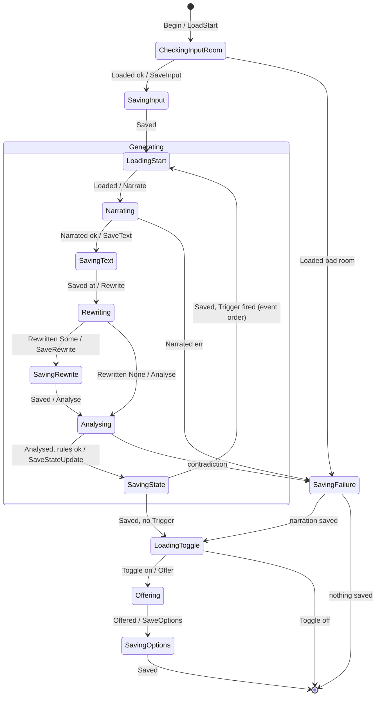

# Prototype: the Job as a pure state machine, next to a straight `generate`

Type: prototype
Status: resolved
Blocked by: —

## Question

Is the Job clearer and safer when it is definitely a state machine, a pure `next(state, event) -> (state, effects)` with a small runner, than when it is a straight `generate` function with early exits? And does the busy state of a Game (the job entry) earn the same shape?

The owner judges the two shapes side by side. The prototype supplies the comparison. It does not decide.

## Context

- **Source.** [Research 01](../assets/research-01-state-machines-and-reducers.md) §3.6. The busy state of a Game probably earns the state-machine shape. The Job is the open case: stop, failure, hooks and the event generation meet there, but its flow is a straight line.
- **The design.** [Target design](../../turn-state-model/assets/target-design.md) §4.2 (plans), §4.3 (steps), §4.4 (states after a stop or a restart), §3.3 (guard, job id check). [Sketch 25](../../turn-state-model/assets/sketch-25-new-design.md) §3.2 (`GameWriter`, `JobWriter`) and §3.3 (`generate`). [Sketch 24](../../turn-state-model/assets/sketch-24-agent-hooks.md) §2.3 (`generate` with hooks).
- **Fork 1 of sketch 25 (Q1).** The owner left the code shape of the plans to the build plan, with one constraint: one `generate` for every kind of generation. Shape P below is a stronger form of option A. This prototype informs Q1. It does not change the constraint.
- **The owner's concerns.** LLM-written code tends to grow (sketch 25 §9, reaction 4). Rules belong in the code structure or in guardrails, not in a written list (sketch 25 §9, Q2). No silver bullet: do not force the idea where it does not fit (owner, 2026-10-15).
- **Terms.** Use `CONTEXT.md`: Job, Action, Message, Swipe, Retry, Trigger. "Turn" and "Action Pipeline" are deprecated.

## Scope

Throwaway code, Rust, in `tmp/` or a scratch crate. Not in `src/`. Fakes for storage and the LLM: no real database, no HTTP.

1. **The slice.** One free-text Action whose analysis fires a Trigger: Input save, Narration generation (all six steps of §4.3), event generation, Options run. Then the same Action stopped at each step boundary.
2. **Shape S (straight).** `generate` and the plan as plain functions with `?`, as in sketch 25 §3.3, with `JobWriter` and the job id check.
3. **Shape P (pure machine).** One state type for the Job; `next(state, event) -> (state, effects)` with no I/O; a runner that does each effect and gives its result back as an event. The status step name comes from the state.
4. **The busy state of a Game, in both shapes.** Shape S: `GameWriter` as in sketch 25 §3.2. Shape P: the job entry as `next(entry, event) -> (entry, answer)` for accept, step, end, stop, reset, restart.
5. **The same tests for both shapes.** The order of the save units for the slice. The §4.4 stop table: a stop at each boundary, and the records that stay. For the busy state: sequences such as accept → stop → late save → accept, as a `proptest-state-machine` test or a hand-written table.
6. **One change to each shape.** Add the rewrite hook (sketch 24 §2.3, step 3b: a new step with its own save unit and status "rewriting"). Record what each shape needed.

## Output

An asset `../assets/prototype-02-job-state-machine.md`, with the prototype code linked (not pasted):

- The two shapes side by side, for the Job and for the busy state.
- A table: lines of code (non-test and test), files touched by the rewrite-hook change, where the stop table lives (code or test), what the compiler checks, and what only a test checks.
- What was hard or unclear in each shape.
- The questions for the owner. Which shape reads more clearly? Does shape P earn its place for the Job, the busy state, both, or neither?

Label each fact known, inferred, or guessed.

## Comments

- 2026-10-15 (prototype session): Built both shapes in [`tmp/prototype-02-job-state-machine/`](../../../tmp/prototype-02-job-state-machine/README.md); the same 10 tests pass for each shape, plus 2 tests that only shape P allows, before and after the rewrite-hook change. Findings and the questions for the owner: [`prototype-02-job-state-machine.md`](../assets/prototype-02-job-state-machine.md). The owner did not choose a shape (see Answer).

## Answer

**No shape is chosen.** The owner has not decided whether the build uses either new shape or the existing design: today's engine code, or the straight `generate` of sketch 25 §3.3 as written (owner, 2026-10-15). This ticket gives both shapes as points of comparison. Shape S follows sketch 25 §3.3 closely, so it is a working version of that sketch, with the job id check and the rewrite hook (inferred).

Code: [`tmp/prototype-02-job-state-machine/`](../../../tmp/prototype-02-job-state-machine/README.md). `tmp/` is git-ignored, so the sketches below keep the shapes. Measurements, mutations and the hard parts: [`prototype-02-job-state-machine.md`](../assets/prototype-02-job-state-machine.md). Its §7 (the author's view) and §8 (questions) are open input for the later choice, not a ruling.

### Option S: the Job as straight code

The order reads from top to bottom. Each `?` is a stop point: the job id check refuses the save, and the Job ends.

```text
run_action()                                   shape_s/job.rs
  start = store.swipe_state(first.start)        # load late: a direct read
  if room not on map → save_failure; return
  save_input(text)?
  n = generate(narration order)?
  if n saved and n fired Trigger T
    generate(event order: start = n.at, T)?
  if n saved and toggle on
    step(Options)?;  offer();  save_options()?

generate(order)                                # design §4.3, every kind
  step(Narrating | GeneratingEvent)?
  start = store.swipe_state(order.start)
  if room not on map → save_failure?; return NOTHING_SAVED
  text = narrate(start)      fails → save_failure?; return NOTHING_SAVED
  at   = save_text(text, start.pre_analysis())?
  step(Rewriting)?;   if rewrite(text) = Some(t) → save_rewrite(at, t)?
  step(Quantifying)?; analysis = analyse(text)
  apply_game_rules(start, analysis)
    ok            → save_state_update(at, state)?;  return { at, fired }
    contradiction → save_failure?;                   return { at, no Trigger }
```

### Option P: the Job as a pure state machine and a runner

`next` does no I/O. Each state waits for the result of one effect.



```text
run()                                          shape_p/runner.rs
  event = Begin
  loop
    (job, effect) = next(job, event)           # pure, machine.rs
    if no effect → return
    if job.step() = Some(s) → writer.step(s) refused? → return
    event = perform(effect)                    # LLM call, read or save unit
              refused save → return            # the stop is handled here, not in next

next(job, event)                               # one match, 20 arms
  (SavingText{start, text}, Saved(at)) → (Rewriting{start, at, text}, Rewrite(text))
  (Analysing{start, at}, Analysed(a))  → (SavingState{at, fired}, SaveStateUpdate{..})
  ...
  (other state, other event)           → panic!   # caught only at run time
```

The data between steps, in the two options:

```diff
 option S: local variables          option P: phase fields (breaks rule 7)
-let start = ...                    +Narrating     { start }
-let text  = ...                    +SavingText    { start, text }
-let at    = save_text(..)?         +Analysing     { start, at }
```

### The busy state of a Game, in both options

```text
option S: GameWriter methods                   shape_s/busy.rs
  accept(game)     under guard: entry exists? → StillThinking
                                 else insert entry; write accept unit
  as_job(job, f)   under guard: entry.job == job? → f()  else Stopped
  stop / reset     under guard: remove entry; write unit
  drop(JobWriter)  under guard: remove entry only if entry.job == my job
```

```text
option P: pure next + one wrapper              shape_p/busy.rs
  next(entry, event) → (entry, answer)
    None,      Accept         → Some(job), Go
    Some,      Accept         → same,      StillThinking
    Some(j),   Step/Save(j)   → same,      Go
    Some(j),   End(j)         → None,      Go
    any,       Step/Save/End  → same,      Refused     # wrong job id
    any,       Stop | Reset   → None,      Go

  transition(game, event, write)
    under guard: (entry, answer) = next(..); store entry
                 answer = Go → write()
```

### The rewrite-hook change, in both options

```diff
 option S: generate()                      (+10 −1 in 1 function)
   at = save_text(text, pre)?
+  step(Rewriting)?
+  if rewrite(text) = Some(t)
+    save_rewrite(at, t)?;  text = t
   step(Quantifying)?
```

```diff
 option P                                   (+19 lines in 2 files)
 enum Effect   { ..., SaveText, + Rewrite, + SaveRewrite, Analyse, ... }
 enum Event    { ..., Narrated, + Rewritten, Analysed, ... }
 enum GenPhase { ..., SavingText, + Rewriting, + SavingRewrite, Analysing, ... }
 Job::step()   + Rewriting | SavingRewrite → Step::Rewriting
 next()        SavingText → Rewriting (was Analysing)
               + Rewriting, Rewritten(Some) → SavingRewrite
               + Rewriting, Rewritten(None) | SavingRewrite, Saved → Analysing
 perform()     + Rewrite → llm.rewrite      + SaveRewrite → writer.save_rewrite
```

Both options also add one `JobWriter::save_rewrite` method (+4 lines in each `busy.rs`).

### The facts for the comparison

All known, from the prototype (asset §3, §4).

| | Option S | Option P |
|---|---|---|
| Job code lines, after the rewrite hook | 116 | 236 |
| Busy-state code lines, with `JobWriter` | 91 | 116 |
| Rewrite-hook change | 2 files, +14 −1 | 3 files, +23 |
| Where the stop table lives | a test | a test: `next` never sees a stop |
| A missing transition | — | compiles, then panics at run time |
| A missing step name | only a test finds it | only a test finds it (the `_` arm of `Job::step`) |
| Every effect has a performer | — | compiler |
| Rule 7 (pass ids between steps) | met | broken: records in the phase fields |
| Shared tests and mutations | the same 10 tests pass; the same defects caught and missed | the same |

### Open for the build plan

The owner's choice among option S, option P and the existing design, for the Job and for the busy state. The questions of asset §8 (gap G1, the rule 7 exception) go with that choice. The map holds this in Not yet specified.

