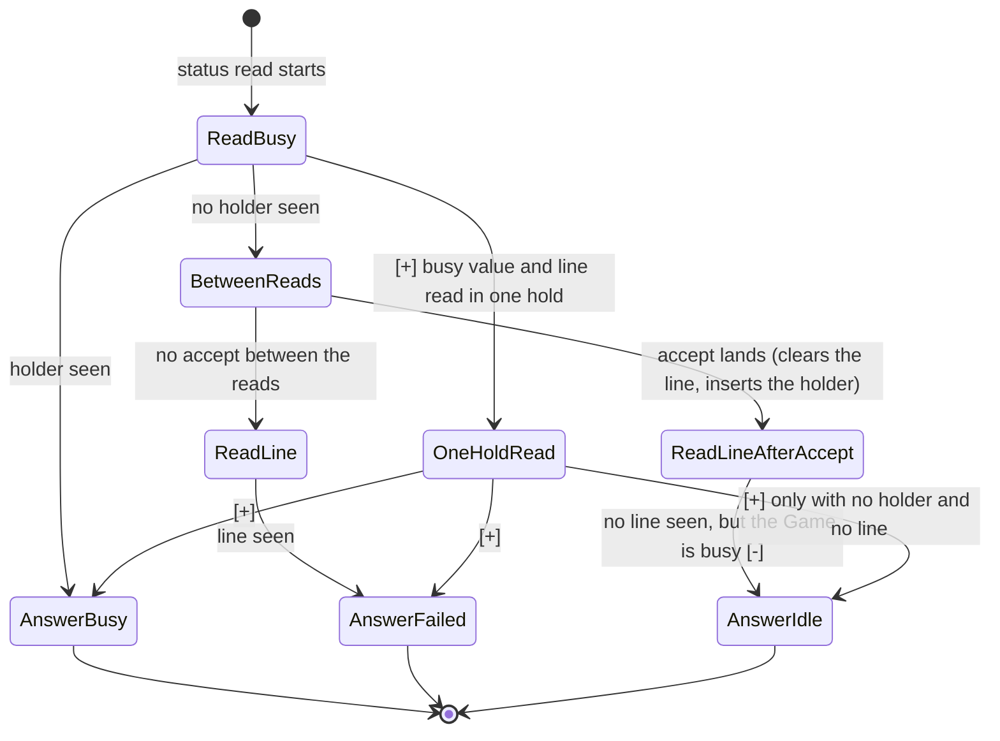
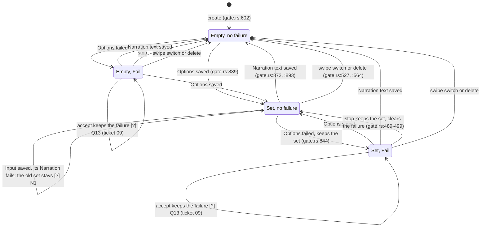
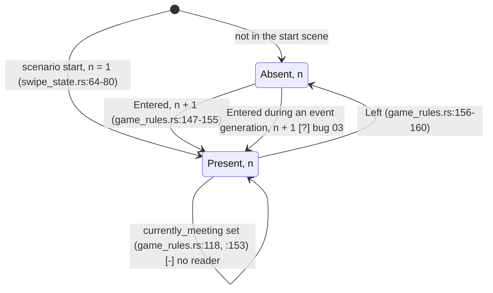
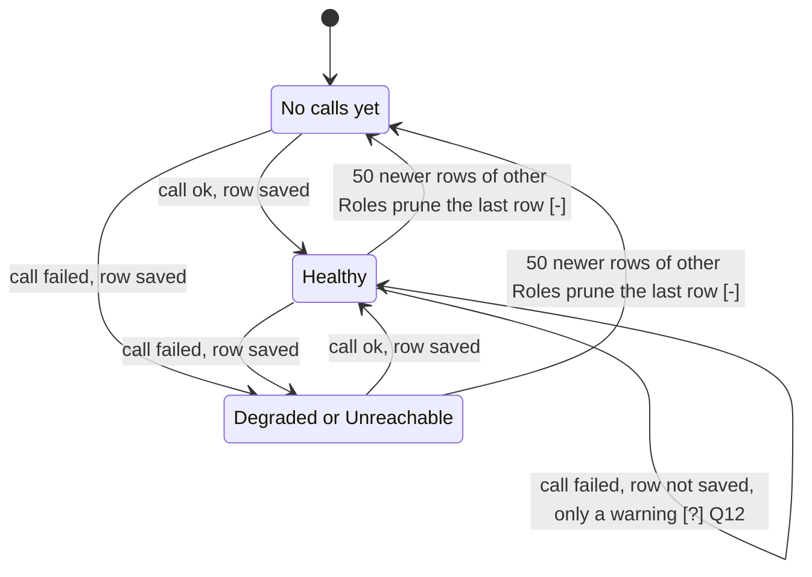
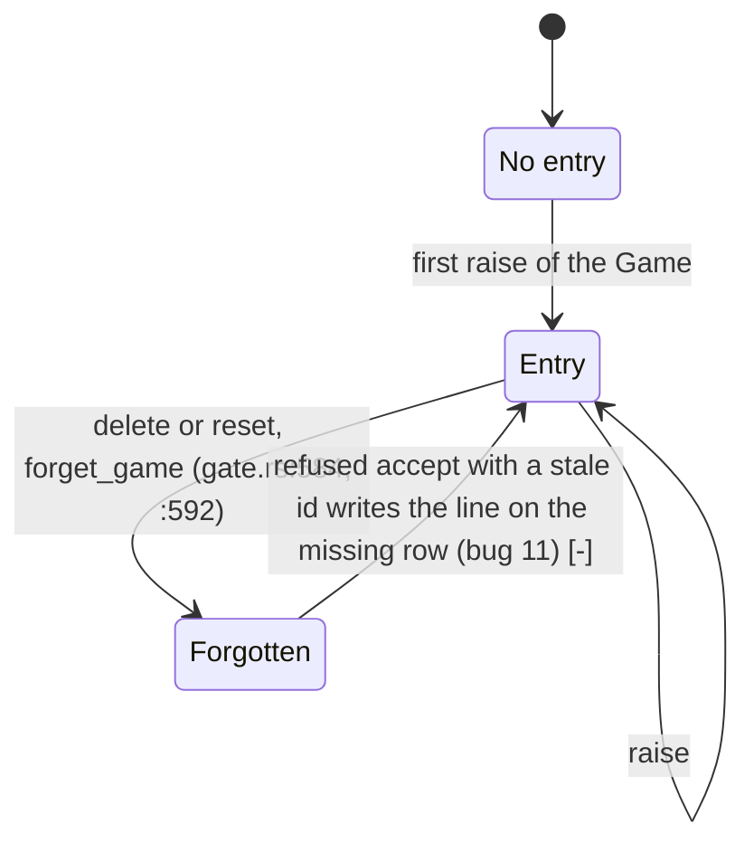
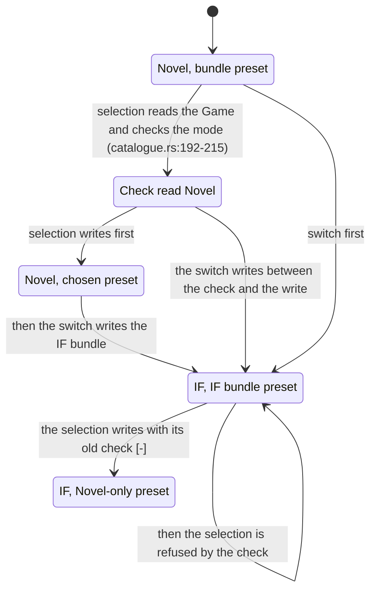

# Ticket 03: review sketches

Review aids for ticket 06, one for each machine of `03-dispositions.md` whose disposition is not "leave it". Each sketch shows the code of the working tree (HEAD `8eb0b057`). A sketch is not a doc, and it never goes into `docs/`.

Marks on the arrows:

- `[+]` an arrow that the disposition adds, or a fix that the disposition checks.
- `[-]` an arrow that the disposition removes.
- `[?]` an arrow that a behaviour question decides. Today's code has the arrow.

## B1: the status read (TLA+ model, extend `verify-gate`)

The answer of one `GET` status read, as two steps today. The Game starts with a failure line and no holder.

N2 (restart) is outside this sketch: after a restart the read answers `Idle` for a Game whose Job never ended `[?]`.

## B2: the dock record (model-based test)

States of the dock record of one Game. "Set" is a non-empty offered set. "Fail" is an Options failure.

The test adds no arrow. It checks each arrow above against the real code, through generated sequences. `[-]` for the dead write: `Tx::clear_dock` (`transaction.rs:321`) is an arrow "any --> E" that no code takes, and W2 removes it.

## B4: the encounters of one Character, with the B3 fire mark (model-based test)

`times_met` is `n`. "Marked" is the fire mark of one one-time Trigger.

Bug 03 decides whether `n` counts every entry or the first only. The test adds no arrow.

## B10: Role health (explicit in the code)

The health that the banner reads for one Role.

The two `[-]` arrows go when the prune keeps the newest row of each Role (W4, if Q6 keeps `dashboard.md:171`).

## B11: the per-Game change numbers (explicit in the code)

The per-Game entry of one Game id in `ChangeCounters`.

After bug 11, `Tx::set_game_failure` fails on a missing row, so the transaction raises nothing and "Forgotten" has no way out.

## B12: the preset selection against a mode switch (TLA+ model, extend `verify-gate`)

One `set_preset_selection` of a Novel-only preset and one `switch_mode` to Interactive Fiction, on an idle Game in Novel mode.

The `[-]` arrow is the race. The `[+]` arrow is the fix that the TLA+ model checks.
