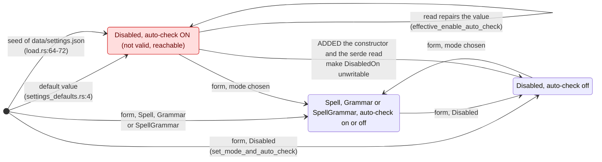
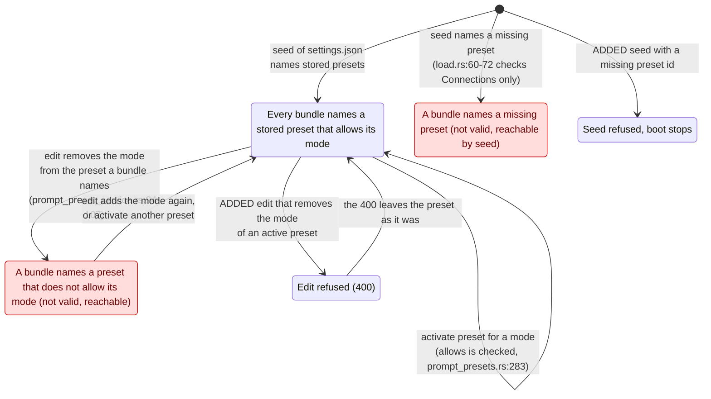
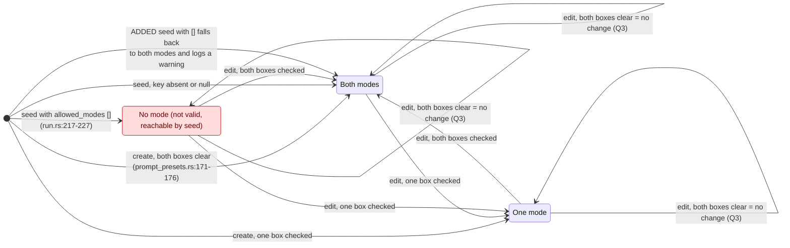
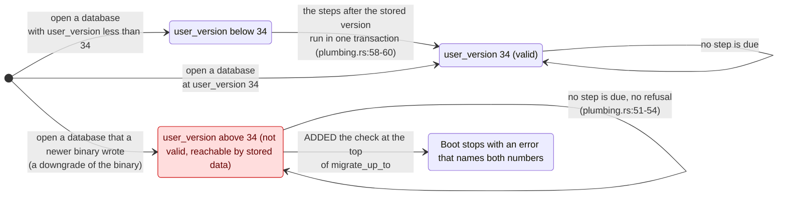

# Ticket 04: review sketches

A sketch is a review aid. It is drawn from the code as it is today. It is not a doc and never goes into `docs/`. Ticket 06 shows these to the owner.

Marks: a **red state** is a state that is not valid and that can be reached. A **dashed arrow with `ADDED`** is a move that the disposition adds. A **`REMOVED`** note names an arrow or state that the disposition removes. Each sketch says which claims are known and which are inferred.

Machines with "leave it" have no sketch: C3, C4, C5, D1, D5, D6, E2, E3, E4. D5 would show only a race, which needs the To-check first.

## D2 Text check: mode and auto-check (explicit in the code)

Today (known): both fields are `pub`. The normaliser repairs the pair on read only. The default, the seed and `data/settings.json:70-71` all hold the red state.

After the disposition: the red state has no entry arrow. The default and the seed come out as `DisabledOff`. No stored JSON changes shape.

## D3 Mode preset registry and the presets (explicit in the code, conditional on Q9)

Today: the check of `allows` is at the activation only. The edit of a preset and the seed make arrows that the check does not see. Path (a) is known; its effect is inferred.

After the disposition: the two red states have no entry arrow. The arrow `Valid --> Disallowed` is **REMOVED**. The arrow `[*] --> Dangling` is **REMOVED**. The two `ADDED` arrows replace them. If the owner answers "no" to Q9, none of this is added and the doc line in `narrator_mode.md:34` is the rule.

## D4 Allowed Modes of a preset (explicit in the code)

Today (known): the list can be empty only through a seed file. The create and edit routes cannot make it. Q3 (both boxes clear) is a form question and stays open.

After the disposition: `[*] --> Empty` is **REMOVED**, so `Empty` and its three arrows are **REMOVED**. The arrow `[*] --> Both` from the seed with `[]` is **ADDED**. The arrows marked "(Q3)" change only if the owner picks the answer "an error".

## E1 Migration ladder and the database version (explicit in the code, conditional on Q5)

Today (known): `migrate_up_to` (`plumbing.rs:25-800`) runs every step after the stored version, in one transaction. No step looks at a version above `LATEST_VERSION`.

After the disposition: the arrow `Newer --> Newer` is **REMOVED**. The old code no longer reads or writes the newer schema.
