# Ticket 05: review sketches of the dashboard machines

These sketches are review aids for the owner (ticket 06). They are drawn from the code as it is today. They are not docs and never go into `docs/`.

How to read them:

- A plain arrow exists in the code today. The label names the cause and the file:line.
- An arrow with the label `ADDED` is one that a disposition adds. An arrow with the label `REMOVED` is one that a disposition removes.
- A red state is a state that is not valid and that a known path reaches. Only G1 and G4 have one.
- The dispositions of each machine are in `05-dispositions.md`. All 15 machines earn at least one, so every machine has a sketch.
- Where the machine has derived states, the sketch shows the derived state and not the variables.

Each state name is a short word. Each label ends with the file name and line of the code that makes the move. `aa` is `dashboard-action-area.js`, `sc` is `dashboard-screen.js`, `sl` is `dashboard-story-log.js`, `dl` is `dashboard-dialog.js`, `er` is `dashboard-errors.js`, `sv` is `dashboard-saves.js`, `pn` is `dashboard-panels.js`, `sm` is `dashboard-slash-menu.js`.

## G1 action area

The state is derived in this order: checking, autoplay, generating, preview, idle (`aa:64-70`).

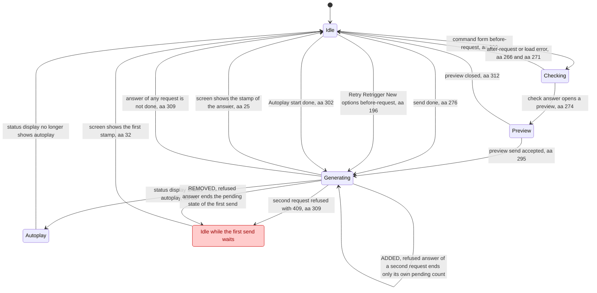

## G2 screen stamp and waiters

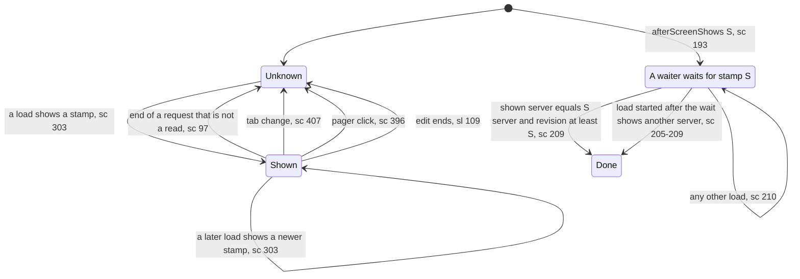

## G3 ask and load loop

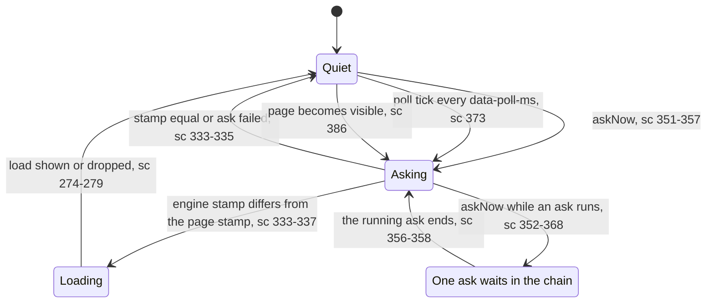

## G4 what a load keeps

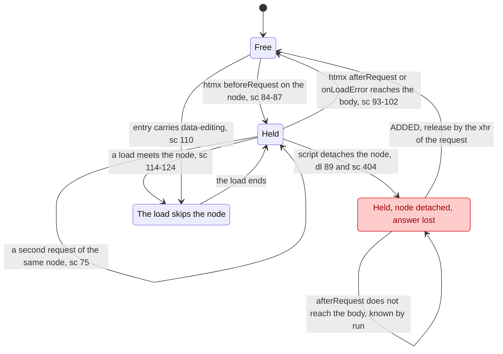

## G5 the Game a request names

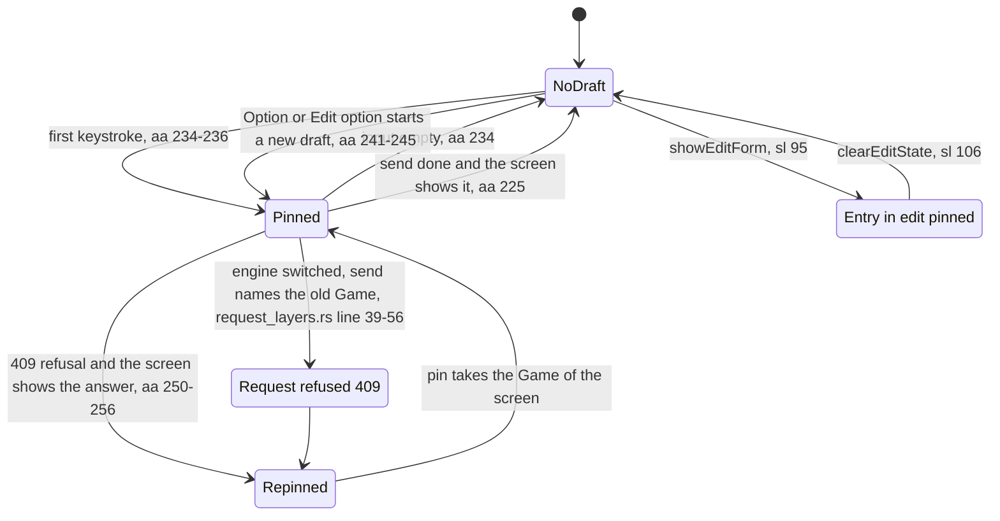

## G6 story-log edit

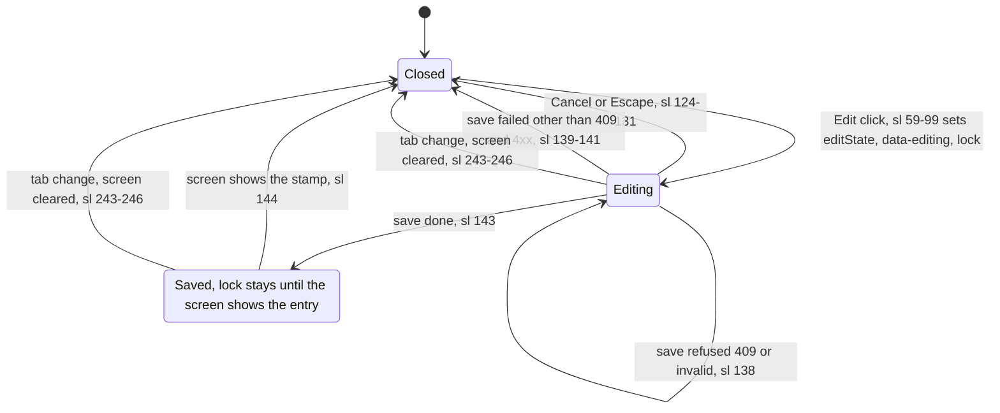

## G7 story-log scroll follow

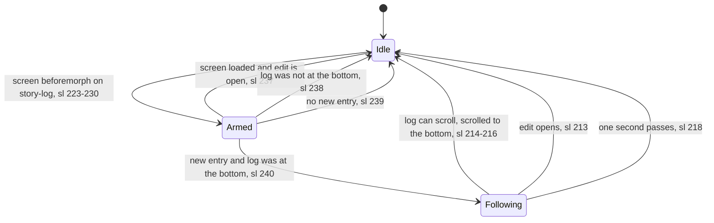

## G8 edit dialog session

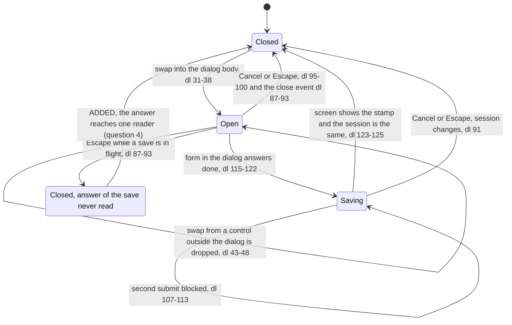

## G9 notice place

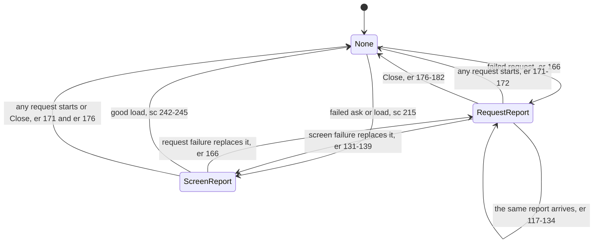

## G10 failure banner

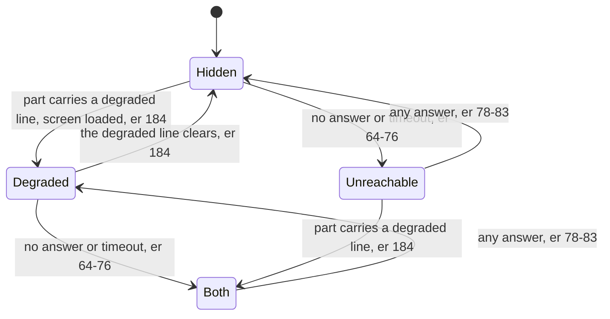

## G11 Saved flag

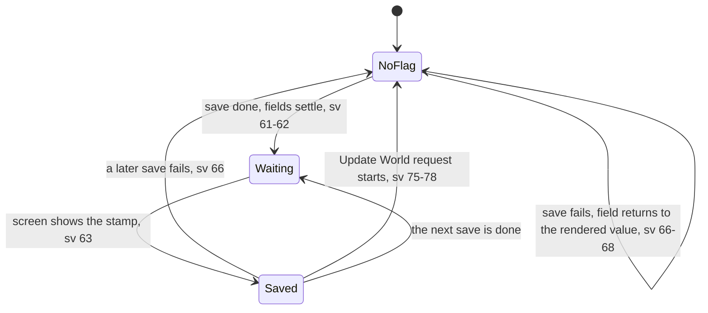

## G12 tab, Settings sub-tab, saved-Games page

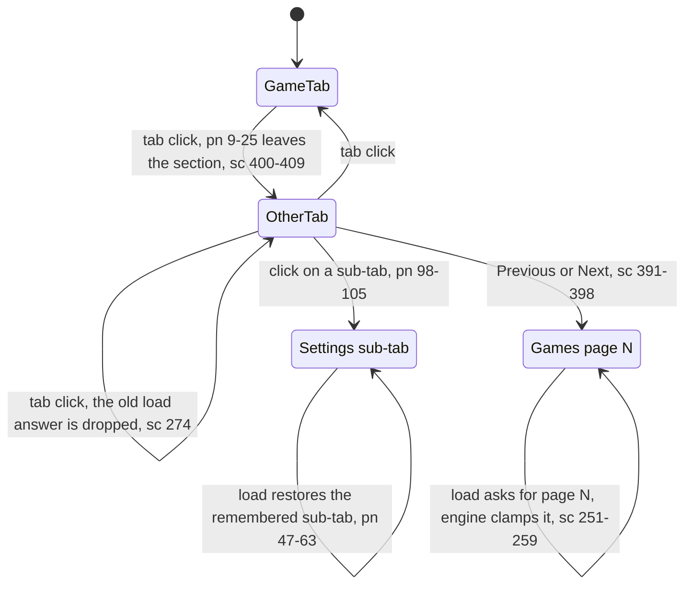

## G13 slash menu

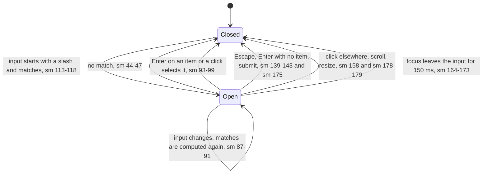

## G14 error detail popover

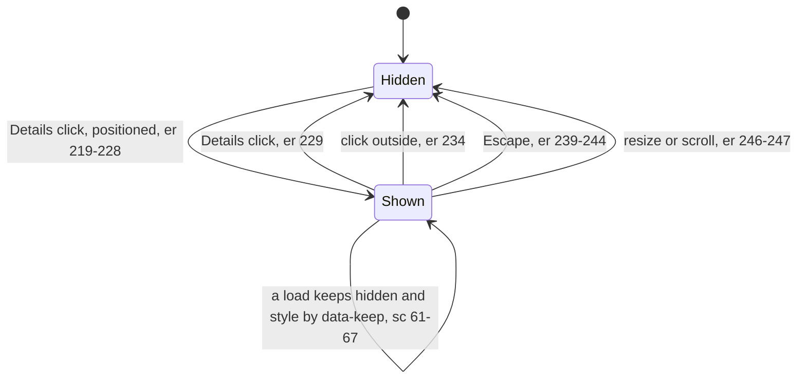

## G15 live-region announcements

Three memories. Each is shown in one block.

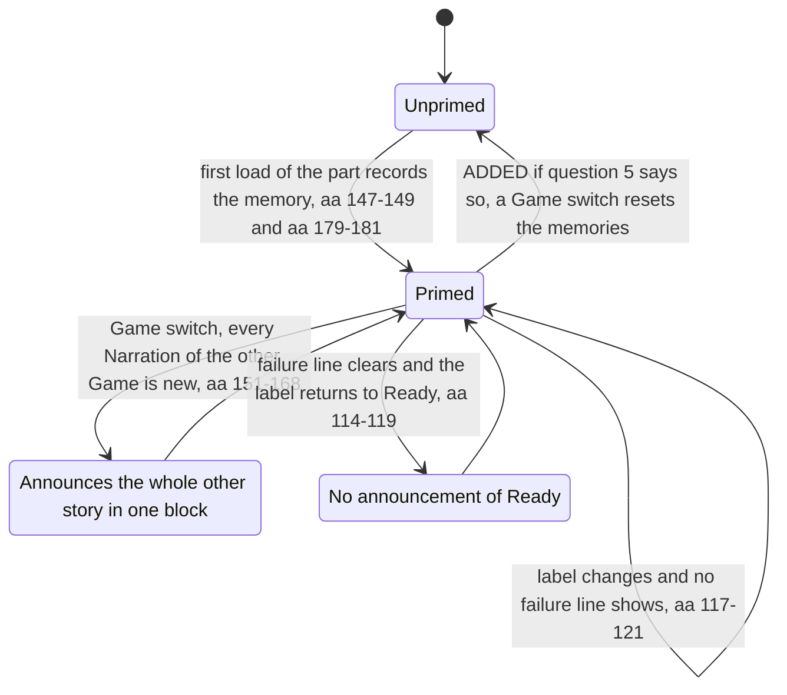
