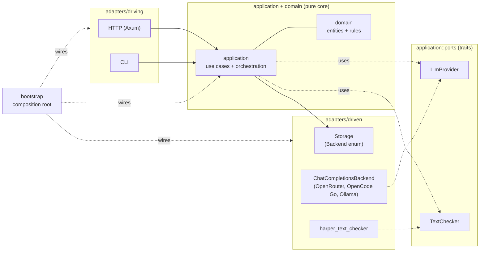

## The dependency rule

The engine is organised around one rule: **domain and application code never import an adapter**. The rule buys two things and costs one.

It buys testability. Domain logic runs without an HTTP server, without SQLite, without an LLM endpoint. The persistence seam and the LLM seam are traits the application core owns and the adapters implement; tests substitute fakes at the trait boundary without booting infrastructure.

It buys substitutability. A backend for another wire format is a new impl and one wiring arm in `bootstrap/`. No application-layer code is edited. The LLM impls exist because the seam makes them cheap; without the seam, every consumer would carry its own dispatch and the impls would fan out through the codebase.

It costs a fixed amount of indirection. The application layer reaches LLM, storage, and text-check through port traits; the cost is one trait declaration per seam and one impl per backend. Where only one impl exists and the consumer is not in core (the storage seam), the trait is rejected as phantom — the rule says you only pay for indirection where the substitution is the point.

## The shape

Dependency arrows point **inward**. `domain` imports nothing from `application` or `adapters`; `application` imports port traits only, never adapter code; `adapters` import `application::ports` to implement the traits; `bootstrap` imports everything and wires it. The direction is enforced by `arch-lint.toml` and visible at every import site.

Two port traits are accepted (`LlmProvider`, `TextChecker`); LLM message persistence runs through a `SaveLlmMessageFn` closure seam (wired to concrete `Storage` in `bootstrap::wiring`). `Storage` is concrete-by-design — the engine's persistence boundary may call it directly, with the `Backend` enum and the `Test` failure layer substituting for a port trait at lower cost.

## The single-process deployment contract

The engine deploys as one process against one SQLite file. The busy-state registry is process-local; two engines pointed at the same database would not see each other's busy Games, and each could start a Job on the same Game. The single-process commitment is the deployment contract — horizontal scaling is not on the table, and the architecture is free to use process-local concurrency primitives (the registry lock, RAII drops of a Job's writer) without paying for cross-process coordination. Restarting the engine is safe because no saved record holds a busy mark: every Game is idle after a start, and every transaction that landed before the restart stays.

## Architectural commitments

Two guarantees follow from the shape above and the deployment contract:

- Domain purity — domain code has no `tokio`, no I/O, no HTTP types, so it is tested without a runtime.
- Tokio-only concurrency — `spawn_blocking` for synchronous services; no `std::thread::spawn` anywhere in `src/`.

## Document References

- [`../reference/architecture_system.md`](../reference/architecture_system.md) — dependency invariant; what each part owns; the storage direct-access carve-out.
- [`../reference/storage.md`](../reference/storage.md) — SQLite schema and its tables.
- [`./rust_idioms.md`](./rust_idioms.md) — concrete services + `spawn_blocking` + settings-sharing shape that the hexagonal frame sits inside.
- [`../reference/coding_standards/guardrails.md`](../reference/coding_standards/guardrails.md) — static guardrails (clippy, arch-lint, syn-based convention tests).