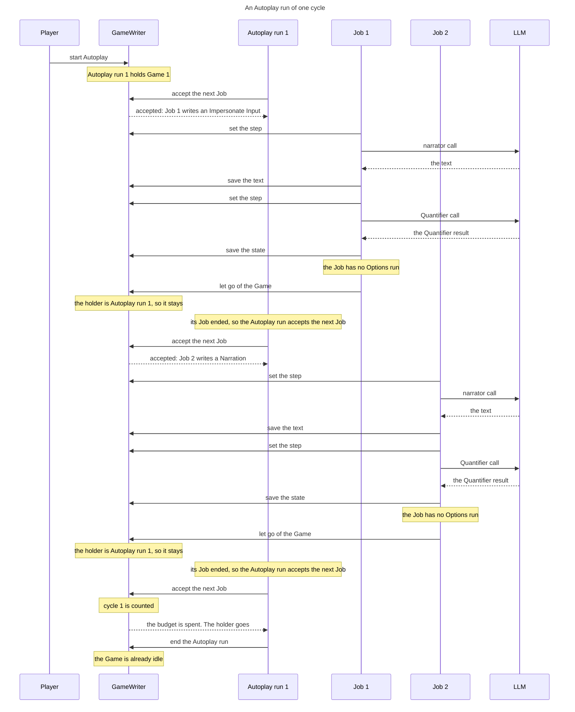

<!-- Generated by verify-gate from its TLA+ model, inputs b8f2bda4a42b6cdf. Do not edit. -->

Rule: An Autoplay run plays no more cycles than its budget.

## Document References

- [Game Flow](../game_flow.md)
