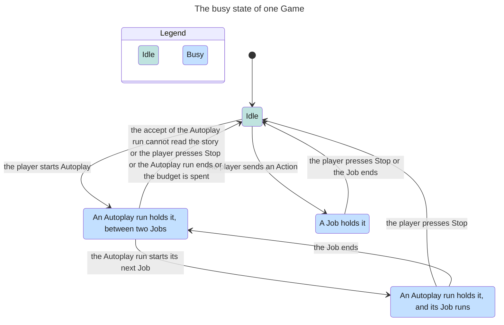

<!-- Generated by verify-gate from its TLA+ model, inputs f76b2202854d3e6a. Do not edit. -->

The TLA+ model of the gate (`.agents/skills/verify-gate/model/`) describes how one holder at a time writes the records of a Game. A holder is a Job or an Autoplay run. This state chart shows one part of it. Its scope: one Game, up to two Jobs, one Autoplay run of one cycle, and Stop. A reset or a delete of the Game is not drawn. The chart merges the 60,976 states that TLC reached into 4 states.

## Document References

- [Game Flow](../game_flow.md)
