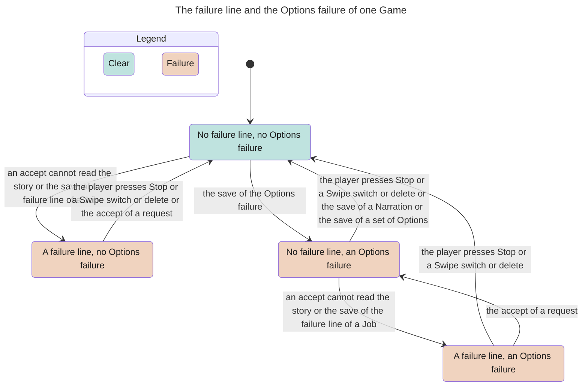

<!-- Generated by verify-gate from its TLA+ model, inputs b8f2bda4a42b6cdf. Do not edit. -->

Scope: one Game, up to two Jobs (Action or Options), one Autoplay run of one cycle, a stop, and the story writes. The model checker reached 75,619 states. The chart merges them into 4.

## Document References

- [Game Flow](../game_flow.md)
