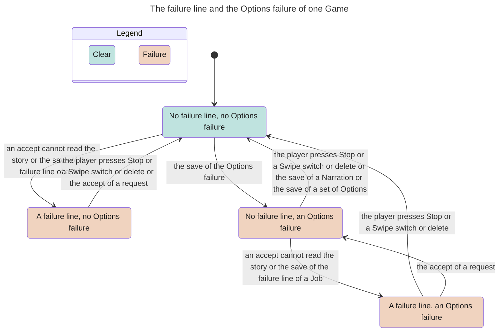

<!-- Generated by verify-gate from its TLA+ model, inputs f76b2202854d3e6a. Do not edit. -->

The TLA+ model of the gate (`.agents/skills/verify-gate/model/`) describes how one holder at a time writes the records of a Game. A holder is a Job or an Autoplay run. This state chart shows one part of it. Its scope: one Game, up to two Jobs (Action or Options), one Autoplay run of one cycle, Stop, and the story writes. The chart merges the 75,619 states that TLC reached into 4 states.

## Document References

- [Game Flow](../game_flow.md)
