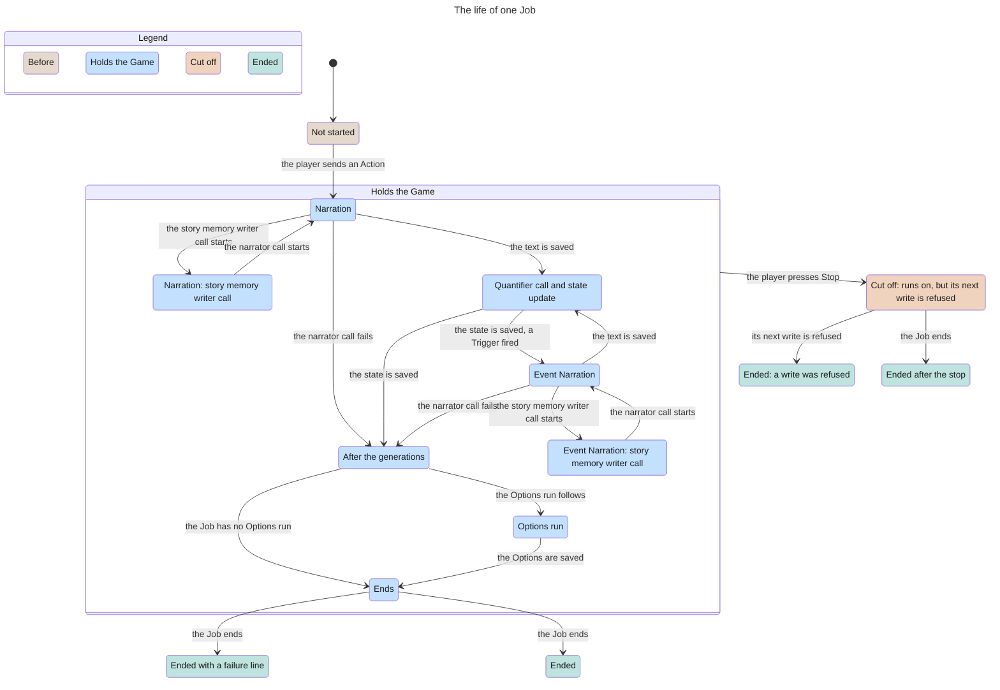

<!-- Generated by verify-gate from its TLA+ model, inputs e77d68a51c5dc729. Do not edit. -->

Scope: one Game, one Action, and a stop. The model checker reached 152 states. The chart merges them into 14.

## Document References

- [Game Flow](../game_flow.md)
