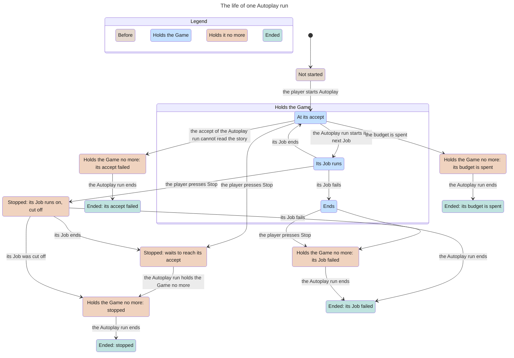

<!-- Generated by verify-gate from its TLA+ model, inputs b8f2bda4a42b6cdf. Do not edit. -->

Scope: one Game, one Autoplay run of two cycles, a stop, the story writes and the config write. The model checker reached 769 states. The chart merges them into 14.

## Document References

- [Game Flow](../game_flow.md)
