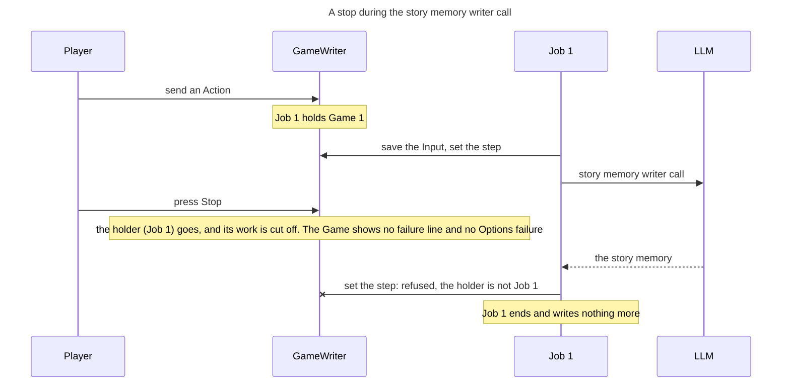

<!-- Generated by verify-gate from its TLA+ model, inputs 3d7ee40469e7ad6a. Do not edit. -->

Rule: After a stop, no write of the stopped Job lands.

## Document References

- [Game Flow](../game_flow.md)
