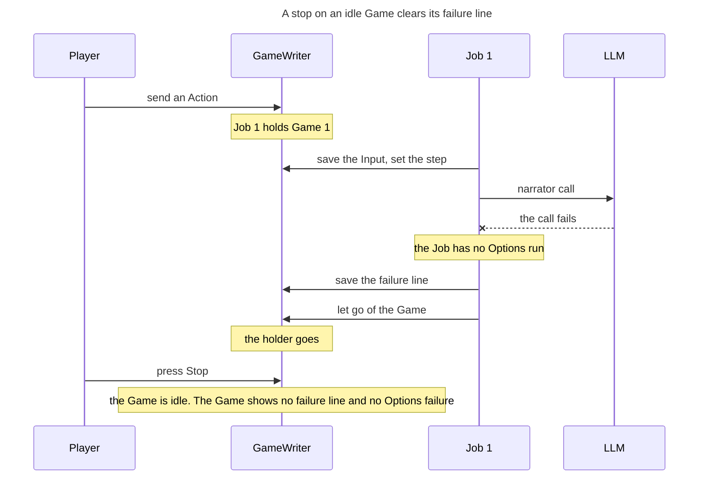

<!-- Generated by verify-gate from its TLA+ model, inputs b8f2bda4a42b6cdf. Do not edit. -->

Rule: A stop leaves the Game idle, with no failure line and no Options failure. The configs of the model check this rule, not this order.

## Document References

- [Game Flow](../game_flow.md)
