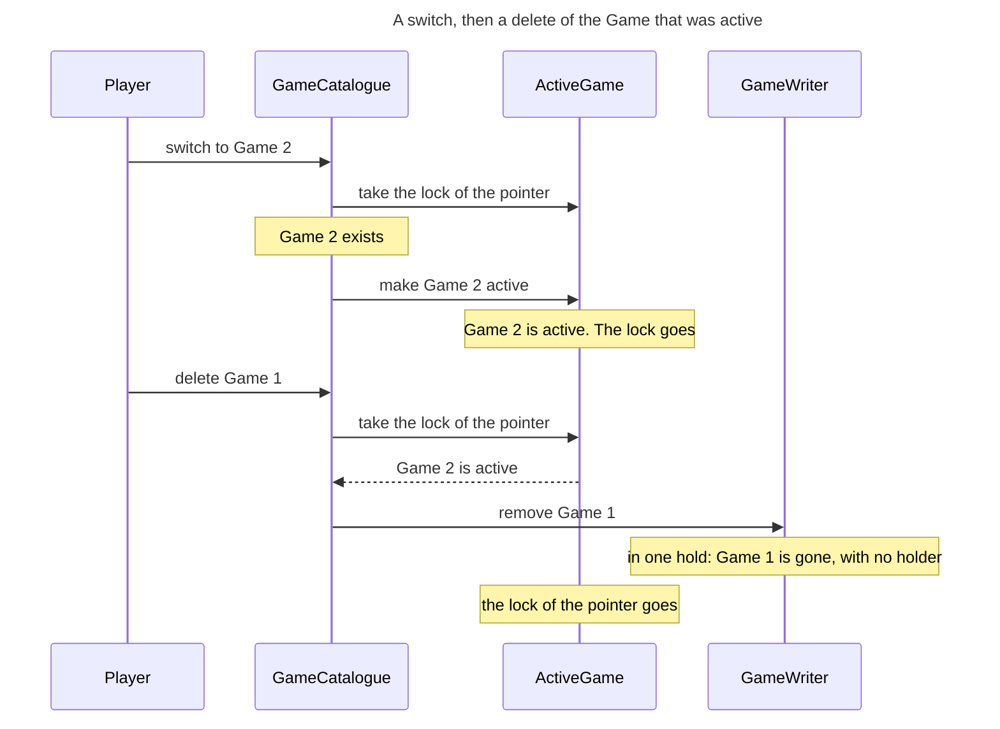

<!-- Generated by verify-gate from its TLA+ model, inputs f76b2202854d3e6a. Do not edit. -->

The TLA+ model of the gate (`.agents/skills/verify-gate/model/`) describes how one holder at a time writes the records of a Game. A holder is a Job or an Autoplay run. This sequence diagram shows one order of its steps, which TLC took one by one. Every invariant of the model held in each state. The order shows this rule: A delete never removes the active Game. TLC checked this rule in each state of the order.

## Document References

- [Game Flow](../game_flow.md)
