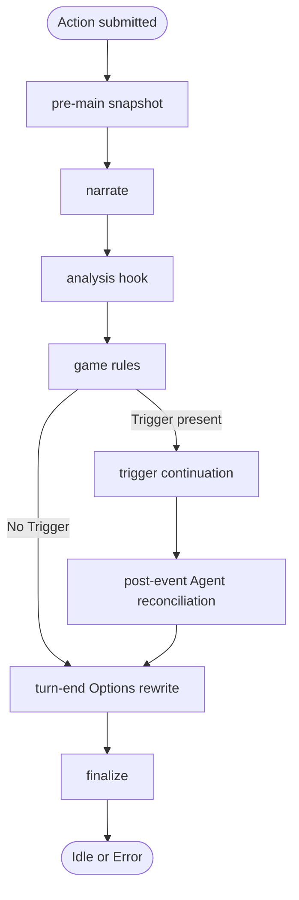

## Overview

A FreeAction moves from player input through narration, scene quantification, the game rules, optional trigger continuation, and finalization. The busy display reads the generation-slot registry; the persisted status supplies the step and the failure.

## Granular Status Steps

`GenerationStatus` carries the coarse state (`Idle`, `Generating`, or `Error`). While it is `Generating`, `Step` supplies the UI-facing stage: `Narrating`, `Quantifying`, `GeneratingEvent` or `Options`. `Error` carries a `GenerationFailure`.

## Step Flow

Normal Actions and main retries run the same success-path steps. Event retry and retrigger enter at trigger continuation.

Phase failures route to finalization. Cancellation exits through the separate contract below.

## Cancellation

`ActionPipeline` and its collaborators are synchronous. `ActionPipeline::claim_and_spawn` offloads the work with `tokio::task::spawn_blocking`, so one blocking task owns the synchronous pipeline run.

`GenerationGate` owns the per-Game slot registry. Claiming a slot assigns a generation id, persists the initial `Generating` state, and then spawns the task. A claimed slot rejects a concurrent Action for the same Game.

The in-phase **α-check** keeps the Game id that the request was accepted for. At each stage boundary, the check compares that id with the active Game from `GameCatalogue::active_game_id`.

A Game switch or reset invalidates stale work at the next boundary. Mismatch returns `PhaseError::Cancelled`.

`GenerationGuard::Drop` releases the per-Game slot on normal return or panic. Guard ownership carries both `game_id` and `generation_id`; drop mutates the registry only while both still identify the claimed slot. Cleanup from an older generation therefore leaves a newer owner's slot intact.

## Trigger Evaluation

Trigger evaluation runs after main narration and the analysis hook, inside the game rules. At most the first matching Trigger produces a continuation for an Action.

The Trigger name becomes event-header metadata on the continuation Message.

### Mutation Order

State mutation preserves this order:

1. Main narration enters history.
2. Movement resolves, then current Characters resolve against the destination.
3. Trigger requirements read the existing encounter log.
4. Character enter/leave events update `currently_meeting` and `times_met`.
5. Trigger context is stored, continuation generation runs, and successful continuation commits event metadata.
6. Post-event Character reconciliation applies after continuation commit.

## Game Rules

`apply_game_rules` in `domain/model/utils/game_rules.rs` holds the game rules. It changes only the `SwipeState` of a Game, and it returns an outcome. `GameState` writes each story change from that outcome.

## Retry Flow

Main retry restores the Snapshot of its anchor Message before generation. Event retry restores the Snapshot of the Swipe it redoes. Retrigger runs on the current state.

## Movement Branch

Movement is a branch of the analysis hook:

- Movement occurs when the Quantifier derives a destination from the narrator's latest outcome.
- A static match updates `movement.current_room_id`. An unmatched destination creates a dynamic pseudo-room, stores it in `movement.dynamic_rooms`, and makes it current.
- The room a movement lands in is the location header of the Swipe whose generation moved the player.
- Movement detection runs on main narration; the post-event Quantifier reconciles Character presence.

Dynamic rooms travel with mutable movement state in Snapshots.

## Text-Check Branch

Text checking branches before Action dispatch and uses the `TextChecker` port with the in-process `HarperTextChecker` adapter.

The text check never blocks an Action: a checker failure sends the original Action.

Only player command text enters the checker.

## Document References

- [`../explanation/two-state-channels.md`](../explanation/two-state-channels.md) — why generation state has two channels.
