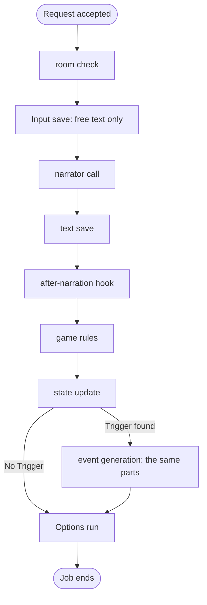

## Overview

A request that generates text starts a **Job**. The engine answers the request at once, and the Job runs in the background. The Job runs the generations of its request and, when one is due, an Options run. Each write of a Job is a save unit that lands whole or not at all. While a Job runs, its Game is busy.

## The Job

These requests start a Job: a free-text Action, `/guide`, `/impersonate`, `/options`, Retry and Retrigger. `Job::start` accepts the request and spawns the Job.

- A Job runs on the Game that its request named. Every write of the Job names that Game, so a Game switch does not change a running Job.
- A Game has at most one Job. A second request for a busy Game is refused.
- A Job runs at most two generations: the Narration, and the event Narration of a Trigger that the game rules fired. It then runs at most one Options run.
- A part that fails ends the Job. Every save unit that landed before the failure stays.
- When the Job saved a Narration or an event Narration, the Options run follows a failure of any later part: the state update, the event generation or the save of the event text. A Job whose entry moved on runs no Options run. The status shows the first failure. A failure of that Options run goes to the log.

## The Plan of a Request

`JobPlan::for_request` in `domain/model/generation.rs` makes the plan of a request. It is a pure function of the request and of the end of the story. A plan holds the free text to save, the first generation and the kind of Options run. A request that has no plan gets one of two refusals: a bad request (`400`) or a missing record (`500`, with the failure line that names the record).

A `GenerationOrder` is the order of one generation. It holds ids and texts only. The kind of the generation carries the data that only that kind has, such as the event record of an event generation.

`GenerationOrder::write` makes the new Swipe of a generation. It is the one place that decides the Message kind, the message type, the maker, the stored inputs, the event header and the Swipe state of the text save.

A Retrigger is allowed when `Tail::retrigger_allowed` says so: the last Message is a Narration that is not an event Narration, or an Impersonate Input, and the current state holds a trigger context. The story log button reads the same rule from the story window.

## The Job Entry and Busy

`GameWriter` owns one registry of **job entries**, one for each busy Game. A job entry holds the Job's id and the current `Step`. A Game is busy when its job entry exists.

No saved record holds the busy mark or the step. A restart loses every job entry, so every Game is idle after a start.

## The Writer Rule

`GameWriter` in `application/generation/gate.rs` is the only code that opens a save unit. It holds every write to a Game's story records, dock record and failure line: accept, stop, edit, delete, swipe switch, create, reset and delete of a Game. A running Job writes through its own `JobWriter`. `GameCatalogue` writes the Game's config columns: its display name, its posture, its mode, its preset selections and its options toggle.

- `accept` reads the end of the story and asks `JobPlan::for_request` for the plan. It then checks that the records the plan names exist: the Game, the Persona and the start state.
- Each save method of a `JobWriter` checks, in one hold of the registry, that the job entry of the Game still holds the Job's id. When the check fails, the save is refused and the Job ends with no further write.
- A stop, a reset and a delete of the Game remove the job entry. A late save of their Job lands nowhere.
- A hold covers one check and its save units. No hold spans an LLM call, so the Jobs of different Games run at the same time.
- An edit, a delete and a swipe switch are refused while the Game is busy. The refusal comes before every other check.

## Steps

`Step` names the part of the work that the status shows: `Narrating`, `Quantifying`, `GeneratingEvent` and `Options`. Each step sets its name in the job entry before it runs.

## The Parts of a Generation

Every kind of generation runs the same parts, and each part runs under one Step. The kind changes the inputs and skips some parts.

- The text save shows the text in the story log. The after-narration hook, the game rules and the state update follow it.
- A user regen ends at the text save. It runs no after-narration hook.
- A part that fails writes the failure line, which is a save unit, and the Job ends.
- Each part loads by id the records it uses, makes one call, and returns its result. Between parts only ids, texts and part results move. A save unit reads nothing: the part that calls it loads the values and gives them to it.

## The Failure Lines

One rule picks the failure line of a part. `accept` and the Job use the same rule.

- A read that fails, or finds no row, gives the missing-data line: "The data for this request is missing: <record>." `Record` names each record. The raw error is in the disclosure. A missing preset of the Narrator or of a hook gives this line, with the record `Preset`.
- A write that fails gives "The new text could not be saved."
- A failed state update gives the contradiction line. A state that the game rules refuse gives the same line.
- A failed model call or prompt assembly gives the line of its error class.
- A failed event generation gives "The event narration failed." The line of the failure under it is in the raw text.

## Status

The status of a Game has one rule. A busy Game shows the step of its job entry. A Game that is not busy and holds a failure line shows that line. Any other Game is idle. The accept unit clears the failure line, and a stop, a swipe switch and a delete clear it too.

`GameViewQuery` holds the rule. The reason for its two sources is in the Explanation doc listed below.

## Stop and Reset

A **stop** removes the job entry, clears the failure line and clears the notice of the dock record. The Game is idle at once. The Job starts no further step, and the id check refuses any later save of the stopped Job. Every save unit that landed before the stop stays. A model call that runs when the stop comes runs to its end, and the id check refuses its answer.

A **reset** creates a new Game and removes the active Game with its job entry. Both writes land in one hold. A Job that ran on the removed Game writes nothing more.

## The State of a Game

Each Swipe holds one **Swipe state**: the room, the added rooms, the Characters present, the encounter records, the fired one-shot Triggers and the trigger context. No record holds a live state of the Game.

- The **current state** is the Swipe state of the active Swipe of the last Message.
- The **start state** of a Message is the Swipe state of the active Swipe of the Message before it. For the opening Narration, it is the Swipe state of its first Swipe. `Tail` derives both.
- Only the Job that makes a Swipe writes its Swipe state, at most twice: the **pre-analysis state** at the text save, and the analysed state at the state update. `SavedText` carries the Swipe from the first write to the second.
- A stop or a restart between the two writes leaves the Swipe with its pre-analysis state.
- An edit changes the text of a Swipe only. A swipe switch and a delete change which Swipe state is current. They write no Swipe state.

An event Narration's Message holds its **event record**, the Trigger that started it.

The room is one fact: the room of the Swipe state. `SwipeState::room` finds it: a map room, else an added room.

## The Story Window

The story log shows the **story window**: the newest Messages of the Game, oldest first. `GameViewQuery::story_window` reads the entries and the end-of-story facts in one storage read, so a Job cannot save a Message between them. The facts include whether a Retrigger is allowed. The last entry of the window is the last Message of the story, and the last-entry controls act on it.

The story log derives the room name that a Message shows from the Swipe state of its active Swipe. A Message shows its room name when that name differs from the room name of the Message before it. The oldest Message of the window always shows its room name. Two rooms with one name count as one room name.

## Create and Reset

One save unit creates a Game. It writes the Game record, an empty dock record and the opening Narration. The opening Narration holds one Swipe: the World's opening text, which can be empty, and the starting state. No LLM call writes it. A reset runs the same unit, so a Game always holds its opening Narration.

A Game switch touches the Game's `updated_at` and then moves the active-Game pointer. `GameCatalogue` is the only writer of the pointer.

## Trigger Evaluation

Trigger evaluation runs inside the game rules, after the after-narration hook. The first matching Trigger fires. The game rules return the event record of the fired Trigger, with its direction rendered. The record becomes the trigger context of the Swipe state, and it starts one event generation. The Trigger name becomes the event header of the event Narration's Message.

### Mutation Order

The game rules apply the Quantifier result in this order:

1. Movement resolves.
2. The Characters present are set from the Quantifier result.
3. Trigger requirements read the encounter records, before the next part of the generation changes them.
4. Character enter and leave events update `currently_meeting` and `times_met`.

The event generation starts from the Swipe state that the state update saved. Its game rules run with no movement and no Trigger check, and its Swipe state holds no trigger context. A one-shot Trigger counts as fired from the pre-analysis state of its event Narration onward.

## Game Rules

`game_rules::apply` in `domain/model/utils/game_rules.rs` holds the game rules. The Job calls it once per generation. It returns the new Swipe state and the event record of a fired Trigger. The storage adapter builds the `GameWorld`.

## Retry Flow

A Retry redoes the generation of the kind that the last Message holds, as a new Swipe on that Message. It starts from the start state of that Message. A Retry of a Narration keeps its guide, and a Retry of an Impersonate Input keeps its direction, if it has one. A bare `/impersonate` runs with no direction, and so does a Retry of its Input. A Retrigger writes a new event Narration from the event record in the trigger context of the current state.

## Movement Branch

Movement is a branch of the game rules:

- Movement occurs when the Quantifier derives a destination from the narrator's latest outcome.
- A static match updates `movement.current_room_id`. An unmatched destination creates a dynamic pseudo-room, stores it in `movement.dynamic_rooms`, and makes it current.
- Movement detection runs for a Narration and an Impersonate. An event generation moves nobody and updates the Characters present.

Dynamic rooms travel with the Swipe state.

## Text-Check Branch

Text checking branches before Action dispatch and uses the `TextChecker` port with the in-process `HarperTextChecker` adapter.

The text check never blocks an Action: a checker failure sends the original Action.

Only player command text enters the checker.

## Document References

- [`../explanation/two-state-channels.md`](../explanation/two-state-channels.md) — why the status has two sources.
- [`./storage.md`](./storage.md) — the records and save units that the Job writes.
