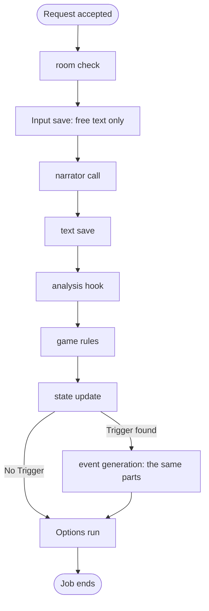

## Overview

A request that generates text starts a **Job**. The engine answers the request at once, and the Job runs in the background. The Job runs the generations of its request and, when one is due, an Options run. Each write of a Job is a save unit that lands whole or not at all. While a Job runs, its Game is busy.

## The Job

These requests start a Job: a free-text Action, `/guide`, `/impersonate`, `/options`, Retry and Retrigger. `Job::start` accepts the request and spawns the Job.

- A Job runs on the Game that its request named. Every write of the Job names that Game, so a Game switch does not change a running Job.
- A Game has at most one Job. A second request for a busy Game is refused.
- A Job runs at most two generations: the Narration, and the event Narration of a Trigger that the analysis found. It then runs at most one Options run.
- A part that fails ends the Job. Every save unit that landed before the failure stays. When the first generation saved its Narration, the Options run still runs, even when the event generation fails.

A `JobPlan` holds the order of one request, and a `GenerationOrder` the order of one generation.

## The Job Entry and Busy

`GameWriter` owns one registry of **job entries**, one for each busy Game. A job entry holds the Job's id and the current `Step`. A Game is busy when its job entry exists.

No saved record holds the busy mark or the step. A restart loses every job entry, so every Game is idle after a start.

## The Writer Rule

`GameWriter` in `application/generation/gate.rs` is the only code that opens a save unit. It holds every write to a Game's story records, dock record and failure line: accept, stop, edit, delete, swipe switch, create, reset and delete of a Game. A running Job writes through its own `JobWriter`. `GameCatalogue` writes the Game's config columns: its display name, its posture, its mode, its preset selections and its options toggle.

- Each save method of a `JobWriter` checks, in one hold of the registry, that the job entry of the Game still holds the Job's id. When the check fails, the save is refused and the Job ends with no further write.
- A stop, a reset and a delete of the Game remove the job entry. A late save of their Job lands nowhere.
- A hold covers one check and its save units. No hold spans an LLM call, so the Jobs of different Games run at the same time.
- An edit, a delete and a swipe switch are refused while the Game is busy. The refusal comes before every other check.

## Steps

`Step` names the part of the work that the status shows: `Narrating`, `Quantifying`, `GeneratingEvent` and `Options`. Each step sets its name in the job entry before it runs.

## The Parts of a Generation

Every kind of generation runs the same parts, and each part runs under one Step. The kind changes the inputs and skips some parts.

- The text save shows the text in the story log. The analysis and the state update follow it.
- A user regen ends at the text save. It has no analysis.
- A part that fails writes the failure line, which is a save unit, and the Job ends.

## Status

The status of a Game has one rule. A busy Game shows the step of its job entry. A Game that is not busy and holds a failure line shows that line. Any other Game is idle. The accept unit clears the failure line, and a stop, a swipe switch and a delete clear it too.

`GameViewQuery` holds the rule. The reason for its two sources is in the Explanation doc listed below.

## Stop and Reset

A **stop** removes the job entry, clears the failure line and clears the notice of the dock record. The Game is idle at once. The Job starts no further step, and the id check refuses any later save of the stopped Job. Every save unit that landed before the stop stays. A model call that runs when the stop comes runs to its end, and the id check refuses its answer.

A **reset** creates a new Game and removes the active Game with its job entry. Both writes land in one hold. A Job that ran on the removed Game writes nothing more.

## The State of a Game

Each Swipe holds one **Swipe state**: the room, the added rooms, the Characters present, the encounter records, the fired one-shot Triggers and the trigger context. No record holds a live state of the Game.

- The **current state** is the Swipe state of the active Swipe of the last Message.
- The **start state** of a Message is the Swipe state of the active Swipe of the Message before it. For the opening Narration, it is the Swipe state of its first Swipe. `Tail` derives both.
- Only the Job that makes a Swipe writes its Swipe state, at most twice: the **pre-analysis state** at the text save, and the analysed state at the state update. `SavedText` carries the Swipe from the first write to the second.
- A stop or a restart between the two writes leaves the Swipe with its pre-analysis state.
- An edit changes the text of a Swipe only. A swipe switch and a delete change which Swipe state is current. They write no Swipe state.

A Swipe also holds the room report that its Message shows. An event Narration's Message holds its **event record**, the Trigger that started it.

## Create and Reset

One save unit creates a Game. It writes the Game record, an empty dock record and the opening Narration. The opening Narration holds one Swipe: the World's opening text, which can be empty, the starting state, and the starting room as its room report. No LLM call writes it. A reset runs the same unit, so a Game always holds its opening Narration.

A Game switch moves the active-Game pointer and touches the Game's `updated_at`. `GameCatalogue` is the only writer of the pointer.

## Trigger Evaluation

Trigger evaluation runs inside the game rules, after the analysis hook. The first matching Trigger starts one event generation. The event record keeps the Trigger name, and the name becomes the event header of the event Narration's Message.

### Mutation Order

The game rules apply the analysis in this order:

1. Movement resolves.
2. The Characters present are set from the analysis.
3. Trigger requirements read the encounter records, before the next part of the generation changes them.
4. Character enter and leave events update `currently_meeting` and `times_met`.

The event generation starts from the Swipe state that the state update saved. Its analysis runs with the movement taken out, and a Trigger that its rules report is ignored. A one-shot Trigger counts as fired from the pre-analysis state of its event Narration onward.

## Game Rules

`apply_game_rules` in `domain/model/utils/game_rules.rs` holds the game rules. It changes a `SwipeState` and returns an outcome. The Job turns the outcome into the state update.

## Retry Flow

A Retry redoes the generation of the kind that the last Message holds, as a new Swipe on that Message. It starts from the start state of that Message. A Retrigger writes a new event Narration from the current state and its trigger context.

## Movement Branch

Movement is a branch of the analysis hook:

- Movement occurs when the Quantifier derives a destination from the narrator's latest outcome.
- A static match updates `movement.current_room_id`. An unmatched destination creates a dynamic pseudo-room, stores it in `movement.dynamic_rooms`, and makes it current.
- The room a movement lands in is the room report of the Swipe whose generation moved the player.
- Movement detection runs for a Narration and an Impersonate. An event generation moves nobody and updates the Characters present.

Dynamic rooms travel with the Swipe state.

## Text-Check Branch

Text checking branches before Action dispatch and uses the `TextChecker` port with the in-process `HarperTextChecker` adapter.

The text check never blocks an Action: a checker failure sends the original Action.

Only player command text enters the checker.

## Document References

- [`../explanation/two-state-channels.md`](../explanation/two-state-channels.md) — why the status has two sources.
- [`./storage.md`](./storage.md) — the records and save units that the Job writes.
