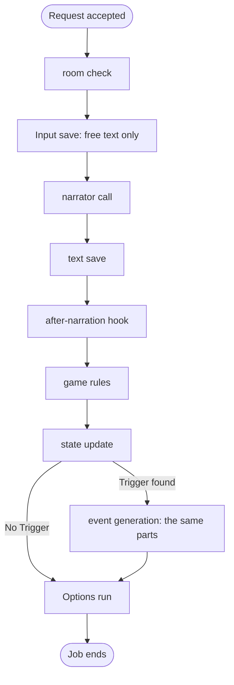

## Overview

A request that generates text starts a **Job**. The engine answers the request at once, and the Job runs in the background. Each write of a Job is a transaction that lands whole or not at all. While a Job runs, its Game is busy.

The TLA+ model of the gate, `.agents/skills/verify-gate/model/`, holds the order of steps between the parts that run at the same time. TLC, the model checker, checks it, and the model generates the diagrams of the gate. A state chart merges the states that TLC reached in one scope. A sequence diagram is one order of steps that TLC took, with every invariant held in each state.

## The Job

A free-text Action, `/guide`, `/impersonate`, `/options`, Retry and Retrigger start a Job. An Autoplay run starts plain Jobs one after the other, and it owns the budget and the cycles.

- A Job runs on the Game that its request named, and every write of the Job names that Game.
- A Job runs at most two generations: the Narration, and the event Narration of a fired Trigger. Then it runs at most one Options run.
- A part that fails ends the Job. Every transaction that landed before the failure stays.

`JobPlan::for_request` makes the plan of a request, as a pure function of the request and the end of the story. A `GenerationOrder` holds the ids and the texts of one generation. `GenerationOrder::write` is the one place that decides the new Swipe of a generation.

## The Gate

`GameWriter` in `application/generation/gate.rs` owns the busy-state registry. The registry maps each busy Game to its **holder**: a plain Job or an Autoplay run. A Game has at most one holder. The **job entry** of the holder names the running Job and its `Step`. The holder lives in memory only, so every Game is idle after a start.

The **writer rule** makes `GameWriter` the only code that opens a transaction. A running Job writes through its own `JobWriter`. The **id check** of each `JobWriter` save compares the Job's id with the job entry of the holder. A stop, a reset and a delete remove the holder, so the id check refuses the later saves of that Job. Each hold of the registry covers one check and its transactions, and it ends before an LLM call starts.

`GameViewQuery` holds the status rule of a Game. It reads the holder from the registry and the failure line from storage.

## The Parts of a Generation

Every kind of generation runs the same parts. The kind changes the inputs and skips some parts.

Each part loads by id the records it uses, makes one call, and returns its result. Between parts only ids, texts and part results move.

## The State of a Game

Each Swipe holds one **Swipe state**: the room, the added rooms, the Characters present, the encounters, the fired one-shot Triggers and the event record. No separate record holds the current state of the Game.

- The **current state** is the Swipe state of the active Swipe of the last Message.
- The **start state** of a Message is the Swipe state of the active Swipe of the Message before it. `Tail` derives both.
- Only the Job that makes a Swipe writes its Swipe state. It writes the **pre-analysis state** at the text save, then the **analysed state** at the state update.
- A Retry adds a Swipe to the last Message, from the start state of that Message.

The story log shows the **story window**, the newest Messages of the Game. The entries of the window and the end-of-story facts always come from the same moment of the story.

One transaction creates a Game with its opening Narration. A reset runs the same transaction. `GameCatalogue` is the only writer of the active-Game pointer. The pointer always names a Game that exists.

## The Game Rules

`game_rules::apply` holds the game rules: movement, the Characters present and the Triggers. The Job calls it once per generation. `game_rules::apply` returns the new Swipe state and the event record of a fired Trigger. An unmatched destination of a movement becomes an added room.

### Trigger Evaluation

The first matching Trigger fires. Its event record starts one event generation. The event generation runs with no movement and no Trigger check. The game rules apply the Quantifier result in this order:

1. Movement resolves.
2. The game rules set the Characters present from the Quantifier result.
3. Trigger requirements read the encounters, before the next part of the generation changes them.
4. Character enter and leave events update `currently_meeting` and `times_met`.

## Document References

- [`./diagrams/busy_state.md`](./diagrams/busy_state.md) — the busy state of one Game. The other diagrams of the gate are in the same folder.
