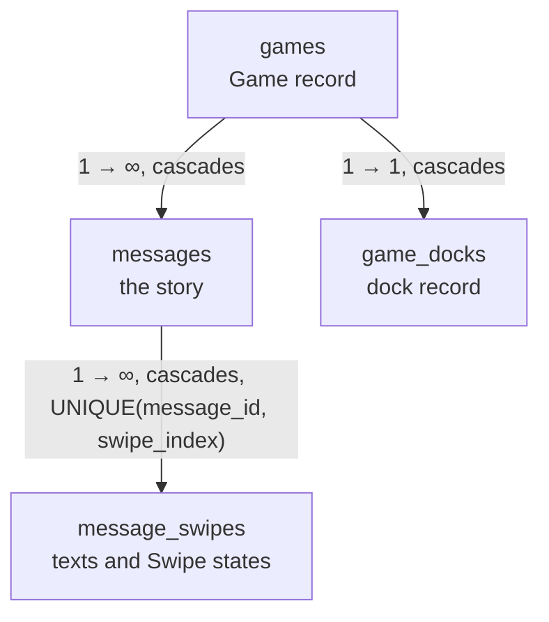
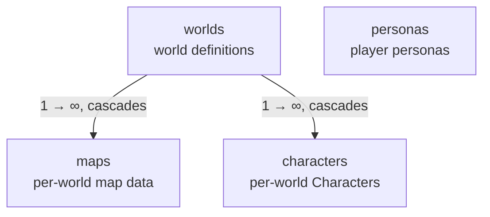

## Overview

`Storage` is the engine's persistence boundary for Games, their stories, settings, and LLM messages. Bootstrap seeding, which writes the first rows, belongs to startup.

## Backend and BackendKind

- **`Backend`** identifies the real storage implementation: `Sqlite`. `Storage::new_in_memory()` opens a SQLite `:memory:` database.
- **`BackendKind`** selects `Direct` access or `Test` failure injection around one `Backend`.
- **Decorator invariant.** `Test` wraps a single `Backend`, never another `BackendKind`. The storage seam therefore permits at most one `Test` layer at a time.

## Game Scoping

Every game-scoped read and write takes its Game as the first argument, typed
`GameId` (`domain/model/game.rs`). The storage adapter unwraps the newtype where
it meets a row or an SQL parameter, so no caller converts.
`Storage` holds no active-Game pointer. The one active Game of the server
process lives in `ActiveGame` (`application/games/active.rs`).
`GameCatalogue` is the only reader and the only writer of `ActiveGame`.
`CurrentGame` reads the active Game through `GameCatalogue` once per request.

## Records of a Game

| Record | Holds | Lives in |
|---|---|---|
| Game | The World, the Persona, the prompt presets, the always-on toggle, the names, and the **failure line** | `games` |
| Message | The place in the story, its kind (typed Input, Impersonate Input, Narration or event Narration) and the active Swipe. An event Narration also holds its event record. | `messages` |
| Swipe | The text, the stored inputs of its generation, the maker and the **Swipe state** | `message_swipes` |
| Dock record | The offered set and at most one Options failure. A Game has one. | `game_docks` |

The holder of a busy Game lives in memory and holds the busy mark.

## Reads of the Story

`Storage::stories()` and `Storage::docks()` return read handles. Each read names its Game.

- **`StoryReads`** (`stories.rs`) reads the end of the story as a `Tail`, one Swipe state, the entries before a Message, and the story window: the newest entries, each with its Swipe state, and the end-of-story facts, in one read. It reads no more of the story than its answer needs.
- **`DockReads`** (`docks.rs`) reads the dock record of a Game.

## Transactions

One `Storage::transaction` call runs one **transaction**: a group of record writes that lands whole. A request can run several transactions. A Job opens one transaction for each save it makes. A transaction holds the backend mutex for its whole run, so the closure of a transaction makes no `Storage` call: that call would wait on the mutex.

- **`Tx`** holds the record writes of one transaction, and every record write exists only on `Tx`. It exists on SQLite only. A `Tx` serves one Game, so no write reaches another Game.
- **`TxToken`** is the capability that opens a transaction. Its constructor is crate-private, and guardrail Rule 3 (call site) limits its callers to `GameWriter`'s registry and `test_support/`.
- **`StorageCall`** is the typed key of one `Storage` method. The test layer fails a method by its `StorageCall`, so a test can fail one `Storage` method.
- **`TxWrite`** is the typed key of one record write. A write checks its key before it writes, so a test can fail one write in the middle of a transaction.
- **`Storage::transaction_new_game`** opens a transaction that creates a Game: it writes the Game row first, so the writes that follow it in the same transaction know the new Game.

A transaction lands **whole, or not at all**. A closure that fails and a closure that panics both roll the transaction back.

## The Newest Game of a World

`Storage::newest_game_of_world` answers the Game a boot picks up for a World.
This read takes no `GameId`, because it finds a Game. The newest Message of the
Game decides the answer, and `games.updated_at` answers it when the Game has no
Message.

## Settings Persistence

Settings occupy a singleton row in the `settings` table — the engine's only settings read source.

## Read Contract: get_* and require_*

`Storage` exposes two absence policies for entity reads:

- **`get_*`** returns an optional result when absence is a valid runtime state.
- **`require_*`** returns a required result and turns absence into a typed error.

## Errors

A statement that SQLite refuses gives `EngineError::Database`. Its `context` names the storage operation that failed, and its `source` holds the rusqlite error. A rusqlite error becomes `EngineError` only through `db_context`, so every storage site names its context. A Message row with no Swipe row is a load error.

## Tables

The tables form three logical clusters:

1. **Game state** — the story and the dock of a Game, rooted at `games`.
2. **World catalogue** — the static world definitions and Characters, rooted at `worlds`.
3. **Standalone** — settings, prompt presets, and LLM messages; independent of any game or world.

### Game state cluster

- **`games`** — top-level Game record. It holds the failure line of the Game.
- **`messages`** — the story of a Game in order. There is exactly one story per game.
- **`message_swipes`** — the Swipes of a Message. A Retry of a Swipe re-applies the steering that the Swipe stores.
- **`game_docks`** — the dock record of a Game.

### World catalogue cluster

- **`worlds`** — world definitions, identified by a unique `key`. Root of the world catalogue: `maps` and `characters` belong to a world.
- **`maps`** — map data per world.
- **`characters`** — Character definitions per world. Each Character has a unique `key` within its world.
- **`personas`** — player personas, identified by a unique `key`. Stands alone — no SQL FK relationships — but referenced logically by `games.persona_key`.

### Standalone tables

- **`llm_messages`** — the LLM messages: one row for each model call, for debugging and prompt engineering. Pruned automatically to a fixed row cap.
- **`prompt_presets`** — prompt preset CRUD (system, quantifier, and other preset types). `id` is a text key. Storage reads, writes and deletes the rows and counts the Games that hold a preset in their preset slots. `PromptPresetService` in the application layer chooses the preset of a Game and decides whether an edit or a delete is allowed.

## Relationships

### Game state cluster

A Swipe holds its own Swipe state, so a swipe switch needs no second record: the active Swipe of the last Message gives the current state.

### World catalogue cluster

### Cross-cluster logical references (no SQL FKs)

Several relationships between clusters are **not** SQL foreign keys. Integrity for these is the application's responsibility:

- **`games.world_key → worlds.key`** (game state → world catalogue) — pins the world a game was created with.
- **`games.persona_key → personas.key`** (game state → world catalogue) — pins the persona a game was created with.

## Document References

- [Storage design](../explanation/storage_design.md) — why the storage layer is shaped this way.
- [Game Flow](./game_flow.md) — the Job that writes these records, and the writer rule.
- [Startup and Bootstrap](./startup.md) — the bootstrap seeding that writes the first rows.
