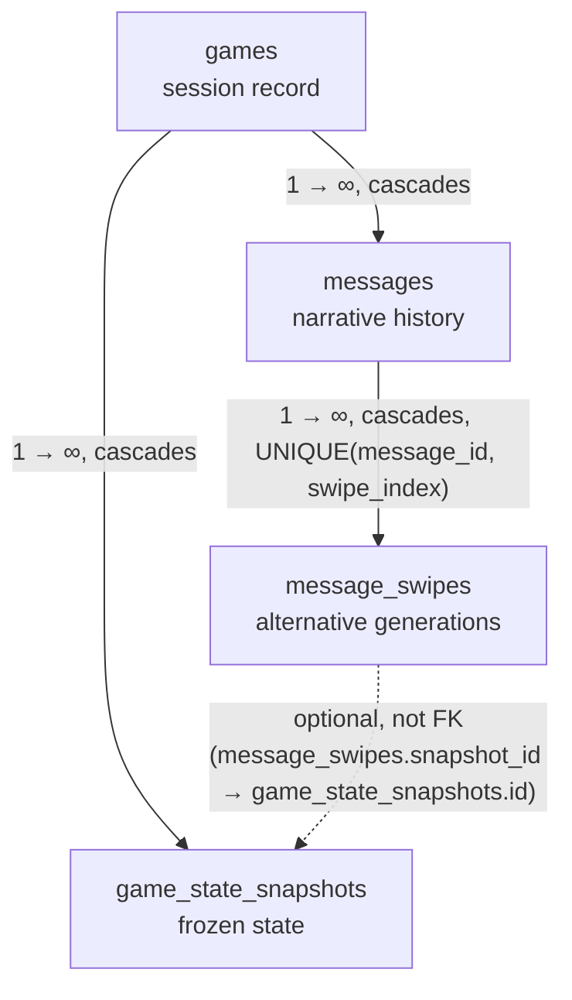
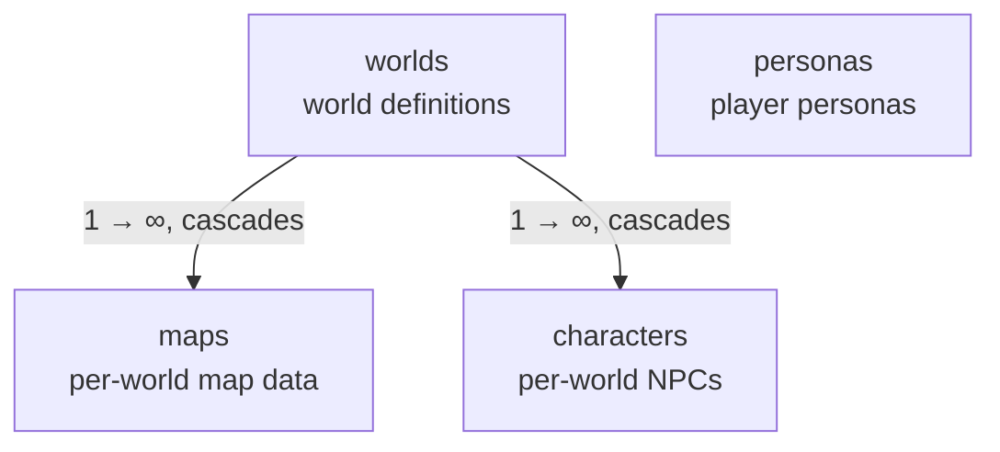

## Overview

`Storage` is the engine's persistence boundary for game sessions, narrative content, settings, and LLM call forensics. Bootstrap seeding, which writes the first rows, belongs to startup.

## Backend and BackendKind

- **`Backend`** identifies the real storage implementations: `Sqlite` and `InMemory`.
- **`BackendKind`** selects `Direct` access or `Test` failure injection around one `Backend`.
- **Decorator invariant.** `Test` wraps a single `Backend`, never another `BackendKind`. The storage seam therefore permits at most one `Test` layer at a time.

## Game Scoping

A `Storage` instance holds the active game id. Game-scoped operations on the `games`, `game_state_snapshots`, `messages`, and `message_swipes` tables use it.

## Settings Persistence

Settings occupy a singleton row in the `settings` table — the engine's only settings read source.

## Read Contract: get_* and require_*

`Storage` exposes two absence policies for entity reads:

- **`get_*`** returns an optional result when absence is a valid runtime state.
- **`require_*`** returns a required result and turns absence into a typed error.

## GameStateSnapshot

`GameStateSnapshot` is a domain-owned DTO persisted by the storage layer. Snapshot JSON contains the serializable game-state subset; message history is persisted in `messages` and hydrated separately.

## Tables

The schema has 11 tables, organized into three logical clusters:

1. **Game state** — the runtime narrative and snapshot data, rooted at `games`.
2. **World catalogue** — the static world definitions and NPCs, rooted at `worlds`.
3. **Standalone** — settings, prompt presets, and LLM call forensics; independent of any game or world.

### Game state cluster

- **`games`** — top-level game session record.
- **`game_state_snapshots`** — frozen point-in-time captures of the mutable game state.
- **`messages`** — chronological narrative history. Each row is one log entry (player input, narration, system message), persisted incrementally. There is exactly one message history per game.
- **`message_swipes`** — per-message swipe versions. A swipe also carries the player-typed inputs of its generation — an impersonation flag and the steering instruction (a guide, or an impersonate direction) — so a retry of that swipe re-applies the same steering.

### World catalogue cluster

- **`worlds`** — world definitions, identified by a unique `key`. Root of the world catalogue: `maps` and `characters` belong to a world.
- **`maps`** — map data per world.
- **`characters`** — NPC definitions per world. Each character has a unique `key` within its world.
- **`personas`** — player personas, identified by a unique `key`. Stands alone — no SQL FK relationships — but referenced logically by `games.persona_key`.

### Standalone tables

- **`llm_messages`** — forensics log of LLM API calls, for debugging and prompt engineering. Pruned automatically to a fixed row cap.
- **`prompt_presets`** — prompt preset CRUD (system, quantifier, and other preset types). `id` is a text key.

## Relationships

### Game state cluster

- **`message_swipes.snapshot_id → game_state_snapshots.id`** — **not a SQL FK**, deliberately. Each swipe carries the snapshot of the state captured *after* the swipe was created; switching swipes restores that exact state. The retry flow depends on this relationship; referential integrity is the application's responsibility.

### World catalogue cluster

### Cross-cluster logical references (no SQL FKs)

Several relationships between clusters are **not** SQL foreign keys. Integrity for these is the application's responsibility:

- **`games.world_key → worlds.key`** (game state → world catalogue) — pins the world a game was created with.
- **`games.persona_key → personas.key`** (game state → world catalogue) — pins the persona a game was created with.

## Messages

The message aggregate has three pieces: `Message`, `Swipe`, and `MessageHistory`.

- **`Message`** — a single narrative unit.
- **`Swipe`** — one alternative generation for a `Message`. The content fields live on the Swipe.
- **`MessageHistory`** — the ordered collection that owns the Messages.

Persistence mirrors this split: identity fields live on `messages`, and content fields live on `message_swipes`.

## Document References

- [Storage design](../explanation/storage_design.md) — why the storage layer is shaped this way.
- [Startup and Bootstrap](./startup.md) — the bootstrap seeding that writes the first rows.
