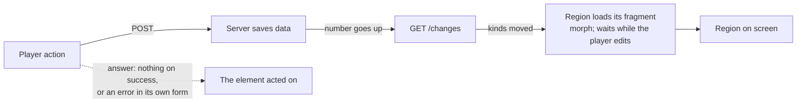

# Plan: Change-driven dashboard refresh

**Date:** 2026-10-25
**Status:** In progress. The design was decided with the owner, reviewed against the code, and the two decisions from the review are made (D1, D2). Stages 1 and 2a are built and committed on `wf/change-driven-dashboard-refresh`; stages 2b–4 are not started.
**Goal:** One architecture for how the dashboard shows server data. Data flows one way: an action saves data, and the regions that show the data load it. A region loads only when its data changed, keeps what the load does not change, and waits while the player edits in it. One table, one load path and one test cover every region. A missed load or a destroyed form fails a test. It does not depend on timing.

This plan replaces `docs/plans/games-panel-rename-form-survives-the-poll.md`, which was never committed. It closes `.scratch/autoplay-follow-ups/issues/04-rename-form-survives-the-games-panel-poll.md` at the end of stage 3.

## Origin

Ticket 04: during an Autoplay run, the Games panel polls every 5 s, and each poll destroys an open rename form. That ticket led to a review of the refresh design as a whole. The evidence is in `tmp/refresh-design/`, which git ignores:
- `inventory.md`: the regions and their protections;
- `history.md`: the bug history;
- `scout-frameworks.md`: how other frameworks solve this;
- `change-sources.md`: the data sources and their writers.

Known findings:

- Seven regions load again on fixed timers (2–5 s), and most swap their whole content. The client state in those regions has 8 separate protection mechanisms and no shared rule.
- Actions also write into regions by several other paths:
  - answers that replace a whole panel;
  - `outerHTML` swaps of a panel element;
  - out-of-band swaps from the header answer into the failure banner and the Settings panel;
  - script writes into the story log and the status display;
  - page reloads (`HX-Refresh`).
- In 26 days, 19 bugs came from this design:
  - 13 where a swap destroyed client state;
  - 6 where a region was stale, or out of step with another region.

  They got 12 different fix mechanisms. `dashboard-ui-review` ticket 65 named the root cause once ("an `hx-swap` replaces the node holding focus, selection or the poll trigger, and the DOM state is lost"). It was still fixed one region at a time.
- The protections cause bugs of their own. `pauseLlmPolling` in `assets/dashboard-panels.js` saves `"none"` as the trigger to restore when a second LLM message is expanded. So after two expands and two collapses, the LLM Messages panel never polls again. This is known from the code. The story-log copy of this code was fixed for the same fault.
- Phase 2 of the dashboard review dropped a cross-panel refresh, for the stale Worlds game count after a Game delete, because the refresh "can wipe unsaved JSON edits".
- The removed ADR-002 (`git show e0f22e00^:chronicler_engine/docs/adr/adr-002-http-polling.md`) chose polling over WebSocket and SSE in 2026-04. The htmx WebSocket extension was "flaky in production", and polling was "simpler, more stable". This plan keeps polling for that reason, but with one poll that only reports changes.

## Decisions

### Owner, 2026-10-25

| # | Decision |
|---|---|
| Q1 | One small version poll, `GET /changes`, replaces the seven timers. Push (SSE) can come later as a transport for the same numbers. |
| Q2 | The server keeps a number for each **kind of data**, not for each screen region. The browser holds one table from kind to regions. |
| Q3 | Story, Options and busy state are counted per Game. A Game switch is an engine-wide change. This prepares ticket 01 (per-tab Games). |
| Q4 | A region waits while the player works in it, and loads once when the work ends. |
| Q5 | A region in a hidden dashboard section is marked stale, and loads when the player opens the section. |
| Q6 | No safety refresh. A save path that does not raise its number fails a test or the build. |
| Q7 | Reset, New Game, Switch Game and Rename use the change mechanism, not `HX-Refresh`. |
| Q8 | The page asks every 1 s while it is visible in the browser. It stops while the browser tab is hidden or minimised, and asks at once when the page is visible again. |
| Q9 | Kind names use the existing name of the data, and the glossary term where one exists: **story**, **Options**, **busy state**, **games**, **worlds**, **settings**, **prompt presets**, **LLM messages**. No `CONTEXT.md` change. |
| Q10 | One plan, four stages, each green on the full gate. |
| — | The numbers are counters, not dates. A counter cannot repeat within a millisecond, and it does not depend on the system clock. A raise may log its time for debugging. |
| — | The four statements of the architecture (next section) apply with no exceptions. Every way that an action or a load changes a region today moves into them. |

**Correction to Q5.** During the session I said "the header and the Game tab are always visible". That is wrong. The Game tab is a section too, and it is hidden while the player is on another section, so the decided rule applies to it as well. Only the header and the failure banner are always visible.

### Owner, from the plan review (2026-10-25)

| # | Decision |
|---|---|
| D1 | **A load keeps the open state of a disclosure.** Disclosures are the rename `<details>`, an expanded LLM message, an open error Details popover, and the active Settings sub-tab. Morph keeps the node but copies the server's attributes onto it, and the server renders every disclosure closed. One idiomorph callback (`beforeAttributeUpdated`, present in the vendored `idiomorph-ext.min.js`) skips the attributes that an element lists in `data-keep`, for example `data-keep="open"`. A new node takes the server's state. Datastar (`data-preserve-attr`) and Turbo (`data-turbo-permanent`) solve it the same way (`scout-frameworks.md`). |
| D2 | **An auto-save control whose save fails goes back to its rendered value**, and the inline error says that the value was not saved. Examples: the posture, mode and preset selects in the Games panel, and the World posture selects. |

Rejected options and why:

- **D1: an open disclosure holds the region.**
  - The region would be stale while a disclosure is open. For example, the LLM Messages panel would show no new message while a card is open.
  - An open error popover would hold the status display. The action area reads its state from the status display, so it would stall, and that needs an exception.
  - The Settings sub-tab bar would have to move into the shell, and the Settings panel would split into two regions with two new fragment endpoints.
- **D2: the select keeps the player's value.** By the hold rule, that value is an edit. So one failed save would stop the whole panel from updating, and nothing on the screen would say why.

## The architecture



1. **Data flows one way.** An action saves data, and it answers with no region HTML. The data reaches the screen only through the numbers: a number moves, and the regions that show that kind load. After any action, the browser asks at once, so the result shows without waiting for the next ask.
2. **An action changes only the element it acts on.** A save answers nothing on success. On failure, it answers its error into the inline slot of its own form, under the existing rule that "a failure never swaps into the region it describes". A view change, such as opening or closing an editor, changes only its own row or the editor slot of its region. It never targets a region element.
3. **A region load keeps what it does not change.** Every region loads through one path: its own `hx-get`, swapped with morph, as the story log does today. A kept node keeps its focus, selection, scroll and view state (D1). If the player edits in the region, the load waits until the edit ends (Q4). If a load removes the focused node, focus moves to the nearest surviving row, or else to the region.
4. **The browser owns view state, and the server owns data.** View state is:
   - the active dashboard section, in the shell;
   - the open state of disclosures and sub-tabs, kept through a load (D1);
   - the action area's own states (Checking, the preview, a send that failed before any Job), in the action area.

Every change to a region is therefore one of two things: a **region load** (statement 3), or a **change to the element acted on** (statement 2). There is no third way, and there are no out-of-band swaps. Guardrail tests enforce this (design §8).

What the four statements cover:

| Problem | Statement |
|---|---|
| A load destroyed a form, typed text, focus or an open element (13 past bugs, ticket 04) | 3, 4 |
| A region was stale, or out of step with another region (6 past bugs) | 1 |
| Prompt Presets Activate and Duplicate answer with the whole panel and drop an edit in another card | 1, 2, 3 |
| Settings actions answer with the whole panel and reset the active sub-tab | 1, 2, 4 |
| The Worlds and Settings editors replace the panel with `outerHTML` or `innerHTML`, so the panel loses its own `hx-get` or its list | 2 |
| The header answer writes into the failure banner and the Settings panel out of band | 3: each element that shows data belongs to one region |
| Focus falls to `body` after a swap (3 past bugs) | 3 |
| The swipe switch writes the story log with `fetch` and `innerHTML` | 1 |
| The action area writes "Generating…" and errors into the live `#status-display` | 4 |
| Four actions reload the page | 1 |
| The two poll pauses, and their fault | 3 replaces them |

## Design

### 1. Data kinds and the browser's table

The browser's table is the `data-live` attribute on each region element in `assets/index.html`. It lists the kinds of data the region shows, so one look at a region tells which changes load it. Its tokens are the field names of the `/changes` answer: `story`, `options`, `busy`, `games`, `worlds`, `settings`, `presets`, `llm`. A guardrail test parses `index.html` (§8).

| Region | `data-live` (kinds) | Renders |
|---|---|---|
| `#header` | games | The active Game's display name. Today the header answer also writes the failure banner and the Settings role-health cells out of band. Those go to their own regions (below). |
| `#failure-banner-degraded` | settings, LLM messages | New region. The engine-wide role-health banner, from a new `GET /fragment/failure-banner`. `#failure-banner` around it stays in the shell. `refreshFailureBanner` shows or hides it, as today. |
| `#story-log` | story, busy state, worlds | Story window; `view_only` while a run holds the Game; room names from the World map. |
| `.visual-sidebar` | story, worlds | Current state; World map and Character images. |
| `#options-dock` | Options, busy state | Dock record (the Options and their failure); buttons disabled while busy. |
| `#status-display` | busy state | Job step, Autoplay progress, the failure line (§7). |
| `.games-panel` | games, worlds, prompt presets | Games list in order of the newest Message, with run marks; New Game World list; posture and preset selects (`#game-posture-controls`). |
| `.llm-messages-panel` | LLM messages | Newest LLM messages. |
| `.settings-panel` | settings, LLM messages | Connections, Roles with their role-health cells, the text check, and the Connections sub-tab marker. The Settings fragment renders the cells and the marker itself. The sub-tab state survives a load (D1). |
| `.prompt-presets-panel` | prompt presets, settings, games | Presets; active preset ids (settings); "used by N Games" counts. |
| `.worlds-panel` | worlds, games | Worlds and maps; which Worlds are in use. |

Kind scope:
- **Per Game** (the active Game for now): story, Options, busy state.
- **Engine-wide:** games, worlds, settings, prompt presets, LLM messages.

Three rules make the table complete:
- **A new or deleted Message also raises "games".** The Games list is ordered by each Game's newest Message (`ORDER BY COALESCE(m.last_message, g.updated_at)` in `storage/games.rs`). A Job in a Game that is not the active one can change that order.
- **A run start or end also raises "games".** The Games list marks the Games that an Autoplay run holds. The step changes inside a run do not raise "games".
- **The failure line is part of the busy state.** `TxWrite::SetGameFailure` raises busy state, because the status display shows the failure line.

The banner and the Settings role-health cells load on the same raise of "LLM messages", from separate reads. Today one header answer writes both, so they cannot disagree. Now they can disagree for less than one ask, and the next load of both makes them agree.

### 2. Server: where the numbers go up

**The counters live in the storage adapter.** `arch-lint.toml` forbids `storage → application`. So `Storage` cannot call a port in `src/application/ports/`, which the plan before review proposed. Storage owns one `ChangeCounters`. The busy registry already holds `Arc<Storage>`, and it raises the busy-state number through it. This needs no new constructor parameter, so no test that builds a `Storage` changes.

- `src/domain/model/change.rs` (new): `ChangeKind` (the eight kinds) and `ChangeVersions` (one snapshot of the numbers, `Serialize`). Plain data, so the server can use `ChangeVersions` without importing storage.
- `src/adapters/driven/storage/changes.rs` (new): `ChangeCounters`. It holds:
  - a server id, a `uuid::Uuid::new_v4()` made at construction (the `uuid` crate is already a dependency);
  - every number under one `Mutex`: the engine-wide numbers, and a `HashMap<GameId, …>` with the three per-Game numbers. The storage guardrail (`tests/infrastructure/guardrails/walker_rows.rs`) bans `Atomic*` types in the storage adapter, and one lock lets a snapshot read all numbers together. The counter lock is always the innermost lock: a raise takes no other lock.
  - `GameWriter::delete` and `replace` drop a deleted Game's entry after their hold returns. A drop inside the transaction would not work, because the hold's own busy raise would make the entry again.

  It also holds the two exhaustive maps, `StorageCall → kinds` and `TxWrite → kinds`. Each map is one `match` with no `_` arm and `#[deny(clippy::wildcard_enum_match_arm)]`. So a new variant does not compile until it names its kinds (Q6).
- `Storage` gets the field `changes: ChangeCounters`. `new_sqlite` builds it, and `with_overrides` carries it over. `Storage::changes()` gives read and raise access to the application.

There are three raise points:

1. **Every storage call: `Storage::with_backend_writes`** (`src/adapters/driven/storage/core.rs`).
   - Every storage method, read or write, goes through `with_backend_mut`, which calls `with_backend_writes` with its `StorageCall`.
   - After the closure returns `Ok`, raise the kinds of the call. A read maps to no kinds. A failed call raises nothing.
   - Examples:
     - `UpdateGameDisplayName` and `TouchGameUpdatedAt` map to games;
     - `SaveLlmMessage` maps to LLM messages;
     - `SaveSettings` and `UpdateSettings` map to settings;
     - `SavePreset` and `DeletePreset` map to prompt presets;
     - `CreateWorld`, `UpdateWorld` and `DeleteWorld` map to worlds.
   - `StorageCall::Transaction` maps to no kinds, because the transaction raises its own kinds (next item). The seed calls run at boot, before any browser exists, so their kinds do not matter.
   - This covers rename, the LLM message recorder, Settings, prompt presets and Worlds with no change to their services. Those are the save paths that bypass `GameWriter` today.
2. **A transaction: `run_transaction`** (`src/adapters/driven/storage/transaction.rs`).
   - `Tx` records the kinds of each write that succeeds, by `TxWrite`:
     - `InsertMessage` and `DeleteMessage` map to story and games;
     - `InsertSwipe`, `SetSwipeText`, `SetSwipeState` and `SetActiveSwipe` map to story;
     - `PutDock`, `PutOptionsFailure` and `ClearDock` map to Options;
     - `SetGameFailure` maps to busy state;
     - `InsertGame`, `DeleteGame` and `SetGameConfig` map to games. The Game row of a create lands before the `Tx` exists, so `run_transaction` records `InsertGame` itself on the create path.
   - After `tx.commit()` returns `Ok`, the transaction raises the recorded kinds once, for its Game. A rolled-back transaction raises nothing.
3. **The busy state: `BusyRegistry::hold`** (`src/application/generation/gate.rs`). This is the only code that takes the busy lock.
   - Before and after the closure, derive the `Busy` value of each held Game. `Busy` already derives `PartialEq`. For each Game whose value changed, raise busy state. This drops the repeated `step()` calls that keep the same value.
   - When the set of Games that an Autoplay run holds changes, also raise games.

The active-Game pointer (`ActiveGame::set`, `set_new`) needs no number. The `game` field of the `/changes` answer shows a change to it, and the `touch_game_updated_at` call in `set` raises games.

**Invariant: a number goes up only after its data is committed.** If a number went up before the commit, the browser could load the old data and then see no further change. The raise in `with_backend_writes` happens while the backend lock is still held. So a fragment load, which needs that lock, always reads the committed data.

### 3. `GET /changes`

```json
{"server":"b7f3c2…","game":7,"story":42,"options":12,"busy":88,
 "games":5,"worlds":2,"settings":3,"presets":1,"llm":230}
```

- The handler sits in `layout/handlers/endpoints.rs`, next to `busy_status_handler`, and takes `Option<CurrentGame>` the same way. It calls `GameViewQuery::change_versions(game)`. `GameViewQuery` already holds `Storage` and `GameWriter`, and it is a read seam (`tests/STRATEGY.md`), so tier-1 tests may observe it.
- It reads only memory, so an ask is cheap. It takes the counters' short lock, not the backend lock.
- With no active Game, it answers `"game": null` and no per-Game numbers.
- With per-tab Games (ticket 01), a later version takes `?game=<id>`. This plan does not build that.

Wiring, from the entry point:
- **Read:** `router.rs` `GET /changes` → `changes_handler` → `AppState.game_view_query` → `GameViewQuery::change_versions` → `Storage::changes()` → `ChangeCounters` snapshot.
- **Raise:** storage-internal in raise points 1 and 2; `GameWriter` → `BusyRegistry::hold` → `Storage::changes()` in raise point 3.

No change to `bootstrap/wiring.rs`.

### 4. The region load path (statement 3)

All of it lives in one new file, `assets/dashboard-live.js`. Each region keeps a **record**: the numbers of its kinds at its last successful load.

```text
every 1 s while document.visibilityState is "visible", one ask at a time
  answer = GET /changes
    a failed ask → markUnreachable(); a good answer → clearUnreachable()
  if answer.server or answer.game differs from the last answer → clear every record
  a region is due when one of its kinds has a number that differs from its record
  for each due region with no load in flight
    its section is hidden     → state "stale"
    it holds an edit          → state "held"
    else                      → state "loading"; htmx.trigger(region, "refresh")
  a load that swaps           → record = the numbers of the ask that started it; state "current"
  a load that fails           → state "due"; the next ask tries again
after any action request ends → ask at once
a section opens (activateTab) → load its stale regions
an edit ends in a held region → load it
the page becomes visible      → ask at once
```

- The per-region record handles held, stale and failed loads with one comparison. A load is never lost, because a region's record moves only when its load succeeds.
- Each region shows its state in a `data-live-state` attribute (`current`, `loading`, `held`, `stale`, `due`). A developer sees in the DOM inspector why a region did not load, and tests can assert the state.
- Every region element keeps its `hx-get` and has `hx-trigger="refresh"` and `hx-swap="morph:innerHTML"`. No region has a `load` or an `every` trigger. The first ask after page start finds no record, so it loads every region. Only the loop starts a region load, so every load has a record (correction after stage 2a: a `load` trigger loaded each region a second time, because a load that no ask started has no numbers to record). `<body hx-ext="morph">` already enables morph.
- `markUnreachable` and `clearUnreachable` (`dashboard-errors.js`) already exist. The loop calls them because its ask is a `fetch`, not an htmx request.
- **The region element is never replaced.** A fragment's root does not repeat the region's own element or class. Today every panel fragment does repeat it (`<div class="games-panel">` inside `<div class="games-panel">`). `dashboard-ui-review` ticket 01 fixed the same fault, but for the story log only.
- **Morph needs stable ids** on repeated items, so that it matches a row to the same row.
  - Already present: the story-log entries, the LLM message cards (`llm-msg-{id}`), and `data-id` on one of the two Games lists.
  - Missing: the other Games list, the Worlds, the preset cards, the connection rows and the role rows. Those get ids.
- **View state through a load (D1).** One callback on `Idiomorph.defaults.callbacks.beforeAttributeUpdated` returns `false` for an attribute that the element lists in `data-keep`. Examples:
  - `data-keep="open"` on a `<details>`;
  - `data-keep="aria-expanded"` on an LLM message header, and `data-keep="hidden"` on its body;
  - `data-keep="hidden style"` on an error popover, and `data-keep="aria-expanded"` on its toggle;
  - `data-keep="aria-selected"` on a Settings sub-tab button, and `data-keep="hidden"` on its panel.

  View state must live in attributes that the server never changes. Do not put it in a class list that also holds server state. The error popover uses `hidden`, not its `open` class.
- **An edit holds a region.** One `htmx:beforeSwap` listener sets `shouldSwap = false` while the target region holds an edit, and sets the region's state to `held`. The listener runs before the focus listener in `dashboard-panels.js`. It also stops a load that was already in flight when the edit began. The prototype below proved this. An edit is:
  - an element with `data-work`: the root of an open editor (the story-log edit, a preset-card editor, the Worlds editor, the connection editor);
  - a dirty field: `value ≠ defaultValue`, `checked ≠ defaultChecked`, or an option with `selected ≠ defaultSelected`.

  When a form's save succeeds, the browser sets each field's default to its current value, and removes `data-work` from the form's editor root. The edit has then ended, and the held region loads with the new data. Until that load arrives, the editor stays in place. When a save fails, the inline error shows, and the edit stays. An auto-save control whose save fails goes back to its rendered value (D2).

  Focus alone does not hold a region, because morph keeps the focused node. The region test (stage 2) is the check, not this list. If the test shows a destroyed state, that state joins the list. An open disclosure does not hold, because the load keeps it (D1).
- **Focus after a removal.** If a load removes the focused node, focus moves to the nearest surviving row, or else to the region. This is one rule in the load path. It replaces `FOCUS_SWAP_TARGETS`, `focusAfterRemovedRow` and the delete-timing guards in `dashboard-panels.js`, as far as the region test shows that they are not needed.
- **The story-log scroll rule stays.** A load that adds entries while the log is at its bottom follows the bottom.

### 5. Actions (statements 1 and 2)

A save answers nothing on success: `hx-swap="none"`, or a script `fetch` that ignores the body. On failure, it answers its error into the inline slot of its own form (`inlineErrorSlotFor` in `dashboard-errors.js`).

**Editors open in place.** The Worlds editor and the connection editor fill an editor slot in their region (`#world-editor`, `#connection-editor`). While the slot holds an editor, CSS hides the list of the region (`:has()`), so the panel looks as it does today. A load of the region renders the slot empty, but the editor's `data-work` holds the region until the edit ends. Cancel empties the slot in the browser, with no request.

Today's actions that change, from `rg 'hx-target' src/adapters/driving/http assets/index.html` and the story-log script:

| Action | Today | After |
|---|---|---|
| Prompt preset create (4 add forms), Duplicate, Activate | Answer the whole `.prompt-presets-panel` (`outerHTML`) | Nothing; the presets number loads the panel |
| Prompt preset save edit | Answers its card | Nothing; the edit ends, and the panel loads |
| Prompt preset delete | Removes its card (`outerHTML swap:0.3s`) | Nothing; the panel load removes the card, and focus moves by the rule in §4. The 0.3 s fade goes. |
| Prompt preset Edit, View, Cancel (view changes) | Replace their card | Unchanged: they replace only their own card |
| Connection save, connection delete, Role select | Answer the whole `.settings-panel` (`innerHTML`) | Nothing; the settings number loads the panel |
| Connection Edit, New (view changes) | Replace the whole `.settings-panel` content | Fill `#connection-editor` |
| Connection Cancel | `GET /fragment/settings` into the panel | Empties `#connection-editor` in the browser |
| Text-check save | Answers `#text-check-card` | Nothing; the panel loads |
| Connection test | Answers into `next .connection-test-slot` | Unchanged: a test result is not stored data, and the slot is its own element |
| World save | Answers the whole `.worlds-panel` (`outerHTML`) | Nothing; the edit ends, and the worlds number loads the panel |
| World Edit, New (view changes) | Replace `.worlds-panel` with `outerHTML`, which drops its `hx-get` | Fill `#world-editor` |
| World Cancel | `GET /fragment/worlds` with `outerHTML` | Empties `#world-editor` in the browser |
| World delete | Removes its row (`swap:0.3s`) | Nothing; the panel load removes the row |
| World posture | Answers `#world-posture-status` | Nothing on success. A failure goes to its inline slot (D2). The status line shows "Saved" from the browser (view state). |
| Game posture, mode, presets selects | Answer `#game-posture-controls` (`outerHTML`) | Nothing; the games number loads the Games panel. A failure follows D2. |
| Game delete | Removes its row | Nothing; the panel load removes it |
| Reset, New Game, Switch Game, Rename | `HX-Refresh` (page reload) | Nothing; the numbers or the new `game` load the regions (Q7) |
| Autoplay start | Answers into `#status-display` | Nothing; the busy number loads the status display |
| Swipe switch (`switchSwipe`) | `fetch`, then `#story-log.innerHTML = html` | `fetch`, then ask at once; the story number loads the log |
| Story-log edit save, delete last, Retry, Retrigger | `fetch`; the log waits for its next poll | `fetch`, then ask at once |
| Command send (`POST /action/check`) | Answers `#action-preview` | Unchanged: the preview is the action area's own element (statement 4) |
| Preview confirm (`POST /action/confirm`) | Its form targets `#action-preview`, but the answer carries `HX-Retarget: #status-display` (`add_status_swap_headers`), so it writes the status display | Nothing on success; the busy number loads the status display. A refusal goes to the action form's inline slot. `add_status_swap_headers` goes (found after stage 2a). |

### 6. The header and the failure banner

- `header_fragment_html` (`builders/headers.rs`) renders only the header. `settings_health_swaps` and the banner part go.
- `GET /fragment/failure-banner` renders the banner from the role health. It uses the same `banner_message` and `banner_detail` as today.
- The Settings fragment renders its role-health cells (`role_health_cell`) and the sub-tab marker (`connections_degraded_marker`) itself. It reads the role health the same way the header handler does today.

### 7. The status display and the action area (statement 4)

- Today `/status/busy` answers machine text ("idle", a step name, a failure disclosure). Then `onStatusPoll` and `setStatus` in `dashboard-action-area.js` rewrite the region with a label from `PHASE_LABELS`. `showStatusError` writes errors into it. `dashboard-story-log.js` calls `showStatusError` and `resetStatusToReady` after a failed Retry, Retrigger or swipe switch.
- After: `/status/busy` renders the display label and a `data-status` attribute with the machine state (`idle`, `thinking`, `autoplay`, `failed`). `onStatusPoll` reads `data-status` after each swap to drive the action-area state machine, and it writes nothing into the region.
- The action area's own states ("Generating…" before the busy number moves, Checking, a send that failed before any Job) show in an element of the action area in the shell, next to the status display.

### 8. Guardrails

The guardrails are one test file in the `guardrails` binary. They fail when:

- an element in `assets/index.html` has an `every` trigger;
- an element with `hx-get` in `index.html` has no `data-live`, or lacks `hx-trigger="refresh"`, or lacks `hx-swap="morph:innerHTML"`;
- a `data-live` attribute lists an unknown kind;
- a template in `src/adapters/driving/http/` or `index.html` has an `hx-target` that names a region element (a selector in the `data-live` set), or swaps a region element with `outerHTML`;
- a template has `hx-swap-oob`;
- a script in `assets/dashboard-*.js` writes `innerHTML` or `outerHTML` of a region element;
- a handler answers `HX-Refresh`, or an `HX-Retarget` that names a region element.

The two exhaustive maps in §2 are checked by the compiler, not by a guardrail.

### 9. Prototype evidence for the hold

The prototype ran on 2026-10-25, in `tmp/proto-rename/`, in headless Chrome, in real time. It used the repo's `htmx.min.js` (1.9.10), the real `dashboard-panels.js` and the stub fixture `games.html`. The guard was a first version of the hold in §4.

| Case | Without the guard | With the guard |
|---|---|---|
| A panel load through `htmx.ajax` | Form element removed; the new form is closed; focus lost | The same element stays: open, typed text, focused |
| A `refresh` event | Same as above | Same as above |
| A load already in flight when the form opened (300 ms server delay) | Same as above | Same as above |
| Close the form after a held load | No load | Exactly one new load |

A note for the tests: a removed `<details>` element still reports `open: true`. So a test must first assert that the element it opened is still in the document. The `data-keep` callback of D1 has no prototype yet. Stage 2 checks it first (stage 2, item 2).

## What already exists

| Need | Existing code |
|---|---|
| One point that every storage call passes | `Storage::with_backend_writes`, keyed by `StorageCall` |
| A name for every write in a transaction | `TxWrite`, already the key of the failure layer |
| The commit point | `run_transaction` in `storage/transaction.rs` |
| The only entry to the busy state | `BusyRegistry::hold`; `Busy: PartialEq` |
| A read seam that holds storage and the writer | `GameViewQuery` |
| A handler that takes an optional active Game | `busy_status_handler` (`Option<CurrentGame>`) |
| A random id | the `uuid` crate (`v4`) |
| Morph | `idiomorph-ext.min.js`, `hx-ext="morph"` on `<body>`, `morph:innerHTML` on the story log; `Idiomorph.defaults.callbacks.beforeAttributeUpdated` |
| The Unreachable banner | `markUnreachable`, `clearUnreachable`, `refreshFailureBanner` in `dashboard-errors.js` |
| Inline error slots | `inlineErrorSlotFor` and the inline-error rule in `dashboard-errors.js` |
| The section switch | `activateTab` in `dashboard-panels.js` |
| Controllable stub endpoints and request counts | `StubStatusHandle`, `StubActionHandle::count`, `StubFailureHandle::set_polls_failing` in `tests/test_utils/stub_server.rs` |
| Full-stack waits | the htmx-settle helpers in `tests/test_utils/htmx_settle.rs` |

## Blast radius

- **Storage:** one new field, two maps, and a raise in two functions. No signature changes, so the ~150 call sites that build a `Storage` in tests stay as they are.
- **`BusyRegistry::hold`:** every `hold` call in `gate.rs` passes through it. Their behaviour does not change; the only addition is the raise.
- **Handlers and their tier-1 tests and specs:** about 20 actions change their answer (§5). The specs that assert a panel body or `HX-Refresh` change:
  - `prompt_presets.md` (about 8 scenarios assert `prompt-presets-panel` or `preset-card` bodies);
  - `games.md` (the posture bodies, Scenario 17.4, and the create, switch and reset scenarios);
  - `settings.md` and `worlds.md`;
  - `autoplay.md` and `failure_display.md` (the `/status/busy` answer gains its label and `data-status`).

  Test files: `tests/http/games_rename.rs`, `games_create.rs`, `games_switch.rs`, `prompt_presets.rs`, `settings.rs`, `worlds.rs`, `games_config.rs`, and the two files in `tests/http/requires_migration/` that assert `HX-Refresh`.
- **Templates:** `builders/presets.rs`, `builders/headers.rs`, and the templates of the settings, worlds, games and prompt-presets modules.
- **Scripts:** all five `assets/dashboard-*.js` files. The `?v=` of each changed script goes up in `index.html` (a convention; no guardrail checks it).
- **Stub tier:** the stub server, the canned fragments in `tests/test_utils/stub_fixtures/` (new fragment roots, row ids, `data-keep`), and the stub checks that mention the pauses, the timers or a poll. `rg -l -i 'pausePolling|pauseLlm|every [0-9]s|statuspoll|poll' tests/browser/stub` finds 11 files today, among them `story_log_edit.rs`, `llm_messages.rs`, `dashboard.rs`, `failure_display.rs` and `autoplay.rs`.
- **Full-stack tier:** the tier-3 tests already reload the page on purpose to read persisted state, so they do not depend on `HX-Refresh`. Their waits may need new limits.

## Failure modes

| New path | Failure | What happens | Handled by |
|---|---|---|---|
| `GET /changes` | The server is down or the network fails | The banner shows Unreachable. The records do not move, so the first good answer loads every region that is due. | §4 (`markUnreachable`) |
| `GET /changes` | The server restarted | A new server id clears every record, so every region loads. The in-memory busy state is gone, and the status display shows idle. | §4 |
| `GET /changes` | A slow answer | One ask at a time. The next ask waits for the answer. | §4 |
| A region load | 5xx or network failure | The region stays due and tries again on the next ask. Today's panel-load error display stays. | §4 (record moves only on success) |
| A region load | It never succeeds | It tries again every 1 s, as the timers do today. `data-live-state="due"` shows it. | Accepted |
| A save path | It raises no number | A new `StorageCall` or `TxWrite` does not compile without its kinds. A write outside storage and the busy state has no number. No such write exists today. | §2 maps; review |
| A save path | It raises the wrong kind | The region that shows the data does not load. The tier-1 test of that save path fails, if one exists. | Stage 1 tests, one per save path |
| A raise | It comes before the commit | Not possible: points 1 and 2 raise after the closure or the commit returns `Ok`. | §2; stage 1 storage case |
| The hold | An edit never ends | The region stays held. `data-live-state="held"` shows it. A failed auto-save goes back to its rendered value (D2), so it cannot hold a region. | §4; region test |
| Morph | A row without a stable id | Morph can replace the node, which loses focus or a `data-keep` state. | Region test |
| `data-keep` | An attribute the server needs to change is listed | The kept node shows stale state. View state must live in attributes the server never sets. | §4 rule; review |
| The Game switch | Another browser tab switches the active Game | The `game` field changes, every region loads, and the hold still protects an edit in progress. | §4 |
| A deleted Game | Its per-Game numbers are dropped | The active Game changes with the delete, so the `game` field changes. | §2 |

## Stages

Each stage ends with `python build.py` green. During a stage, use `python build.py --no-browser` and `test-pattern` runs. Write the spec first: edit or add the spec scenario before its test. See each new test fail before you write the code that makes it pass.

### Stage 1 — Server numbers and `GET /changes`

1. Spec `docs/specs/changes.md`, Scenarios 43.x (tier 1, HTTP; 43 is the next free number):
   - each save path moves exactly its kinds;
   - a transaction with a failed write moves nothing;
   - a busy change moves busy state, and a run start or end also moves games;
   - a new Message in a Game that is not the active one moves games;
   - a Game switch changes `game`;
   - the server id is stable within one process.
2. Storage seam cases in a new `tests/storage/changes.rs`, with `// CASE` tags (the storage contract, `tests/STRATEGY.md` "The one rule"):
   - a committed transaction raises its kinds once;
   - a transaction whose later write fails raises nothing, also for its earlier writes;
   - a failed storage call raises nothing (`Storage::with_failure`);
   - a read raises nothing.
3. Add `ChangeKind`, `ChangeVersions`, `ChangeCounters`, the two maps, the raises in `with_backend_writes` and `run_transaction`, the compare in `BusyRegistry::hold`, `GameViewQuery::change_versions`, and the route. Register the new modules in `src/domain/model/mod.rs`, `src/adapters/driven/storage/mod.rs`, `tests/http/mod.rs` and `tests/storage/mod.rs`. Each new `src/` file starts with its DOC anchor and its summary line (`CODING_STANDARDS.md`).
4. Tests in `tests/http/changes.rs`:
   - one test per save path: every `GameCatalogue`, `SettingsService`, `PromptPresetService` and `WorldCatalogue` operation, and the LLM message recorder;
   - a full Job and an Autoplay cycle on `ScriptedModel`.

   Each test reads `/changes` before and after, and asserts which numbers moved and which did not.
5. Nothing in the browser uses the endpoint yet.

### Stage 2 — The load path, the Game tab and the header

1. Spec `docs/specs/browser_live_regions.md`, Scenarios 44.x (stub-browser tier; tests in `tests/browser/stub/live_regions.rs`, registered in `tests/browser/stub/mod.rs`):
   - a moved number loads exactly the regions that list its kind, and no other region;
   - an unchanged answer loads nothing;
   - a new server id or a new `game` loads every region;
   - a failed ask shows Unreachable, and a failed region load is tried again on the next ask;
   - a hidden browser tab does not ask, and asks at once when it is visible again;
   - an action asks at once when its request ends;
   - an edit holds a region, which then loads once;
   - a kept disclosure stays open through a load (D1);
   - focus moves to a surviving row when a load removes the focused node.
2. **Check `data-keep` first.** Before the rest of this stage, run one stub check: an open `<details data-keep="open">` in a morph region survives a load whose fragment renders it closed. If the vendored idiomorph does not honour the callback, stop and bring D1 back to the owner.
3. **The region test.** One table-driven check per region in `data-live`. For each region:
   - put every interactive control into its engaged state: open each disclosure and editor, type into each field, focus each field;
   - raise each kind that the region lists;
   - assert that the same nodes, values, open states and focus remain;
   - end each edit, and assert exactly one load.

   In this stage, it covers the header, the story log, the visual sidebar, the options dock and the status display.
4. In the stub server (`tests/test_utils/stub_server.rs`), add:
   - a controllable `/changes`, in the style of `StubStatusHandle`;
   - a count of the loads of each fragment path, in the style of `StubActionHandle::count`;
   - `/changes` in what `set_polls_failing` fails.

   Add a test helper for one deterministic ask. The loop exposes one function for a single ask, which returns when every load that the ask started has settled.
5. Add `assets/dashboard-live.js` (`?v=1`), the `data-keep` callback, the hold, the focus rule, and `data-live`, `hx-trigger="refresh"` and morph on the Game-tab regions and the header. In this stage, the header keeps its out-of-band swaps, so its `data-live` is "games, settings, LLM messages" until stage 3.
6. Remove from the Game tab and the header:
   - their timers;
   - the story-log poll pause (`pausePolling`, `resumePolling`);
   - `pollStatusNow` and the `statuspoll` event;
   - `refreshRunRegionsOnRunChange`;
   - the direct write in `switchSwipe`.
7. Convert the Game-tab actions in §5: the story-log actions, the swipe switch and the Autoplay start.
8. The status display and the action area (§7).
9. The guardrails in §8 for `assets/index.html` and the scripts. The template and out-of-band guardrails wait for stage 3.
10. Update the specs that describe the timers, the pause or the client writes for these regions:
    - `browser_story_log.md` (the edit pause becomes the hold);
    - `browser_dashboard.md` and `dashboard.md`;
    - `failure_display.md` (a failed poll becomes a failed ask);
    - `autoplay.md` and `browser_autoplay.md` (the status poll becomes the status display load).

    The tier-3 tests (`tests/browser/autoplay.rs` and others) must pass. Their wait limits may change, but the behaviour they check must not.

### Stage 3 — The panels, the actions, the hidden sections

1. Add `data-live`, the load path and morph to every panel region. Remove the panel nesting (§4), and give the panel rows stable ids. Remove the Games-panel conditional poll, and the LLM Messages poll with `pauseLlmPolling`, `resumeLlmPolling` and `restoreLlmExpandedState`. This also removes the dead-poll fault.
2. The header and the failure banner (§6): remove the out-of-band swaps, add `#failure-banner-degraded` as a region with its endpoint, and let the Settings fragment render its cells and marker. The header's `data-live` becomes "games".
3. Add `data-keep` to every disclosure and sub-tab in the panels. Move the error popover's open state from its `open` class to `hidden`.
4. The editor slots for the Worlds and connection editors (§5).
5. Convert every panel action in §5, including the four page reloads, with D2 for the auto-save controls. Update the specs and tests in the blast radius. Do not lower the pin of `tests/http/requires_migration/`: those tests stay untagged.
6. Add the hidden-section rule (Q5): a due region in a hidden section is stale, and loads when `activateTab` opens the section.
7. Regenerate the canned fragments in `tests/test_utils/stub_fixtures/`, and update the stub checks that used the pauses.
8. Extend the region test to every panel. The Games-panel cases replace the two scenarios that ticket 04's plan proposed (27.4, 27.5):
   - an open rename form survives a raise of each kind that the Games panel lists, with its text and focus;
   - ending the edit loads the panel once.
9. Add the template and out-of-band guardrails from §8.
10. Close ticket 04 with a comment that points to this plan, and set its status.

### Stage 4 — Cleanup and docs

1. Remove what is now unused, as far as the region test confirms it:
   - the focus-restore code that served the old swaps;
   - `restoreOpenErrorDetails`, `rememberOpenErrorDetails` and `openErrorDetails` in `dashboard-errors.js`, which `data-keep` replaces;
   - `ok_refresh` in `utils/response.rs`.
2. Docs:
   - `docs/diataxis/reference/frontend/dashboard.md`:
     - "Shell and Fragments" states the four statements as invariants;
     - the client state list loses "a paused poll", and gains the record and state of each region, `data-keep` and the action area's own states;
     - "Each live region polls its own fragment" becomes: each live region names the kinds of data it shows, and loads when one of them changes.
   - `docs/diataxis/explanation/dashboard_design.md`, "Server-rendered fragments and polling": rewrite it with the reasons:
     - one version poll, because ADR-002 found push unreliable with htmx and polling simpler;
     - numbers per kind, so a load is precise, and the table shows which data each region shows;
     - data flows one way, so there is one path into a region;
     - view state survives a load, and an edit holds the region, because a change can arrive while the player works;
     - counters, not dates.
   - `docs/diataxis/reference/architecture_system.md` ("polling endpoints").
   - `AGENTS.md` and `README.md`: "HTTP/WebSocket server" is stale, because no WebSocket exists. Write "HTTP server".
3. Run `/chronicler-ui-investigator` on a probe server with real connections:
   - an Autoplay run with the Games tab open and a rename form open;
   - an LLM message expanded during a Job;
   - a World edit in progress while a Game is renamed in another browser tab;
   - a preset Activate while another preset card is in edit.

## Done when

- The guardrails in §8 pass. In particular, there is no `every` trigger, no action targets a region, no template has `hx-swap-oob`, no script writes a region, and no handler answers `HX-Refresh`.
- Every region has `data-live`, and the region test covers each one. Each region keeps the player's edits and open disclosures through a raise of each of its kinds, and loads once when an edit ends.
- Each save path has a tier-1 test of the numbers it moves. A new `StorageCall` or `TxWrite` variant does not compile without its kinds.
- `pausePolling` and `pauseLlmPolling` are gone. The LLM Messages panel updates after any sequence of expands and collapses.
- No panel is nested in its own class. No editor replaces a region element.
- The docs in stage 4 match the code.
- `python build.py` passes.

## Risks

- **Morph on large regions.** The LLM Messages panel holds up to 50 messages with full request and response text. A morph compares all of them on each load. It loads only on a new LLM message, so this is a few loads per Job. Measure it in stage 3. If it is slow, the panel can render collapsed bodies and load a body on expand.
- **The Games panel loads more often during a run.** Each new Message raises games (§1), so the Games panel loads about twice per Autoplay cycle. Morph and the hold make that safe. It is a cost, not a fault.
- **One extra round trip after each action.** The action's answer, then an ask, then the region load. On the local server this is a few milliseconds. The UI pass in stage 4 checks how it feels.
- **The 0.3 s delete fade goes.** Deleted rows disappear on the panel load. If the fade matters, it can come back as a morph callback on node removal.
- **The hold list can be incomplete.** The region test is the safeguard. Every engaged state that it shows destroyed joins the list.

## Not in scope

- Push transport (SSE). The counters are its future payload.
- Per-tab Games (ticket 01). `/changes` is ready for a `?game=` parameter.
- The `autoplay_runs` history table (ticket 03) and the Narrator role health after a Stop (ticket 02).
- Any change to the stored schema, the Job pipeline or the busy rule. Only the raises are new.
- A JS framework or a JS build step. The browser side stays htmx 1.9.10, idiomorph and plain scripts.
- A visual redesign. The editors keep their look, and the panels keep their layout.
- The dead `/fragment/character-headshots` route and its template (`inventory.md`). File a separate ticket.
